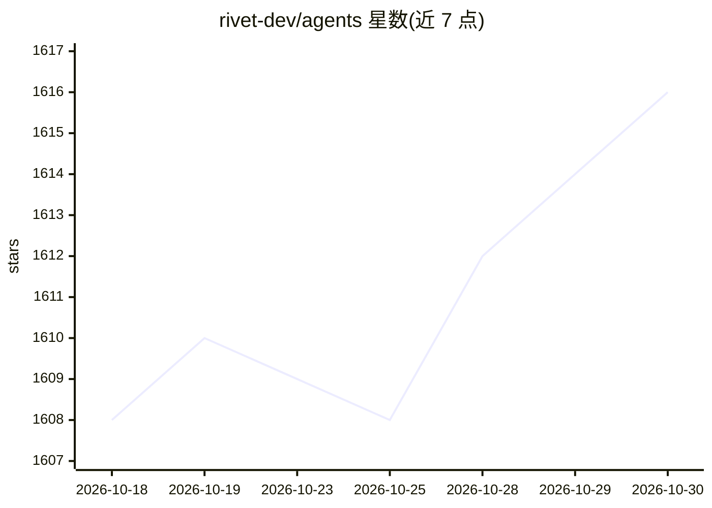

# rivet-dev/agents

⭐ 1,616 · TypeScript · Apache-2.0 · 推送 2026-10-29 · [GitHub](https://github.com/rivet-dev/agents) · [官网](https://rivet.dev/agents/docs) · 组织维护

**Rivet 出品的 agent 基础设施：以持久 Actor 运行 agent**

Rivet 维护的 monorepo，含两个项目：Rivet Agents 将 Pi 等 agent 作为持久 Rivet Actor 运行，提供 @rivet-dev/pi 与 @rivet-dev/sandbox-adapter 两个 npm 包；Sandbox Agent 在沙箱中运行编码 agent 并通过 HTTP 控制。仓库内所有包共用同一版本线发布，使用 just release 脚本统一升版、发布 crates/npm 包并上传二进制。采用 Apache 2.0 许可，文档分置于 rivet.dev/agents/docs 与 sandboxagent.dev。

## 筛选速览

| 维度 | 判定 | 备注 |
|---|---|---|
| AI 角色 | `ai-ecosystem` | LLM/agent 周边工具 |
| 许可风险 | `permissive` | Apache-2.0 |
| 部署形态 | `None` |  |
| 模型依赖 | — | README 未给出锁定关系 |
| 硬件要求 | — | 无带数字的原话,不猜 |
| 安装摩擦 | `low` | 无编译、无系统依赖或容器化 |
| 成熟度 | — | 结构信号不足 |

## 能力要点

- 将 Pi 等 agent 作为持久 Rivet Actor 运行（@rivet-dev/pi、@rivet-dev/sandbox-adapter）
- Sandbox Agent 在沙箱中运行编码 agent 并经 HTTP 控制
- 全仓库单版本线发布：统一升版、发布 crates/npm 包、上传二进制

## 适用场景

- 让 agent 进程跨重启保留状态地持久运行
- 在沙箱环境中运行并远程控制编码 agent
- 基于 Rivet Actor 模型构建 agent 基础设施

## 场景标签

`Agent 框架` `编码 Agent` · 领域:Agent 开发

## 证据(README 行号)

> L9: |**Rivet Agents**: run agents such as Pi as durable Rivet Actors (`@rivet-dev/pi`, `@rivet-dev/sandbox-adapter`)|`pa

## 星数曲线

2026-10-18 1,608 → 2026-10-30 1,616（+8）

---
*卡片 v1 · prompt 1.4 · 生成 2026-10-21 · 置信度 mid · 依据 README sha `29e98d16953d` · [字段定义](../../DATASET.md)*
