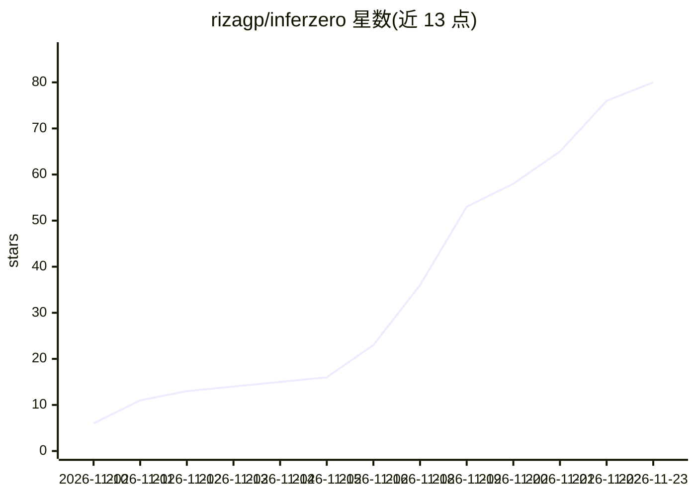

# rizagp/inferzero

⭐ 80 · C++ · Apache-2.0 · 推送 2026-11-22 · [GitHub](https://github.com/rizagp/inferzero) · [官网](https://rizagp.github.io/inferzero/) · 个人维护

**面向 Intel 核显的从零编写的本地 LLM 推理引擎**

用 C++ 基于 Level Zero 编写的推理引擎，针对 Intel 集成显卡（Xe-LPG/Xe2/Xe3）与 Arc B 系列独显，直接加载 GGUF 文件，在 int8 DP4a 单元上构建矩阵运算，支持超出显存的 MoE 专家从 SSD 流式加载、MTP/DFlash2 投机解码与多卡张量并行。提供 OpenAI/Anthropic/Ollama 兼容 API 与带网页搜索、语音对话的 Web UI，可接入 Pi 编码 agent。Windows 与 Linux 提供预编译包，从源码构建需 Visual Studio Build Tools。独显支持为实验性。

## 筛选速览

| 维度 | 判定 | 备注 |
|---|---|---|
| AI 角色 | `ai-ecosystem` | LLM/agent 周边工具 |
| 许可风险 | `permissive` | Apache-2.0 |
| 部署形态 | `desktop` | 安装包/桌面程序 |
| 模型依赖 | — | README 未给出锁定关系 |
| 硬件要求 | — | 无带数字的原话,不猜 |
| 安装摩擦 | `low` | 无编译、无系统依赖或容器化 |
| 成熟度 | `idea` | |

## 能力要点

- 直接加载 GGUF 文件，服务 OpenAI/Anthropic/Ollama 兼容 API 与 Web UI
- MoE 模型专家权重可从 SSD 流式加载，运行大于显存的模型
- MTP + DFlash2 投机解码，声明输出与朴素解码逐字相同
- 支持多张 Arc Pro 卡张量并行（--gpus N）

## 适用场景

- 在无独显的 Intel 笔记本上本地运行大模型
- 为编码 agent（Pi）提供本推理后端
- 在 32 GB 笔记本上运行 35B 级 MoE 模型长上下文任务

## 场景标签

`推理引擎` · 领域:训练与推理

## 证据(README 行号)

> L6: **Fast local LLMs on an Intel laptop iGPU.** A from-scratch inference engine for **Intel integrated GPUs
> L8: C++ on **Level Zero**. It loads GGUF files directly, serves an **OpenAI-, Anthropic- and Ollama-compatible API with

## 星数曲线

2026-11-10 6 → 2026-11-23 80（+74）

---
*卡片 v1 · prompt 1.4 · 生成 2026-11-18 · 置信度 high · 依据 README sha `45dbafbda636` · [字段定义](../../DATASET.md)*
