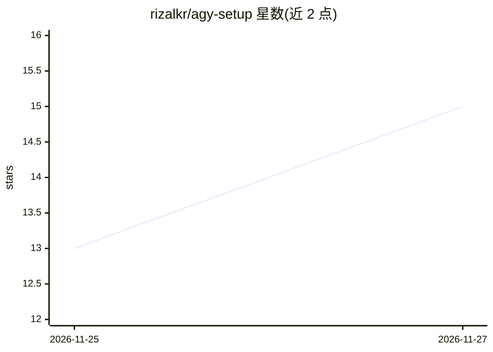

# rizalkr/agy-setup

⭐ 15 · JavaScript · 推送 2026-11-25 · [GitHub](https://github.com/rizalkr/agy-setup) · 个人维护

**为 Google Antigravity CLI/IDE 提供节省 token 的配置方案**

针对 Google Antigravity（CLI、App、IDE）的便携配置集，覆盖 Windows/macOS/Linux。核心机制：6 个 Orchestrator 预设（Argon/Neon 两个系列，分别指定规划与执行模型及压缩阈值）、置空全局 MCP 配置以避免工具 schema 注入每轮上下文、GEMINI.md 全局规则（限定行范围读取、批量并行调用、子代理委托）、带分级技能库的 Skill Router（19 个技能、7 个类别），以及监控步数与 token 并给出压缩建议的 Context Guardian。安装提供 Agent CLI 一键提示词与手动脚本（install.sh/install.ps1）。

## 筛选速览

| 维度 | 判定 | 备注 |
|---|---|---|
| AI 角色 | `ai-ecosystem` | LLM/agent 周边工具 |
| 许可风险 | `none` | — |
| 部署形态 | `None` |  |
| 模型依赖 | — | README 未给出锁定关系 |
| 硬件要求 | — | 无带数字的原话,不猜 |
| 安装摩擦 | `low` | 无编译、无系统依赖或容器化 |
| 成熟度 | — | 结构信号不足 |

## 能力要点

- 6 个 Orchestrator 预设，按任务与 token 预算选择规划/执行模型组合
- 全局 MCP 配置置空，项目级 MCP 服务器按需注入
- 19 技能 7 类别的 Skill Router 与 Progressive Disclosure 技能库
- Context Guardian 按预设阈值监控 token 并提供压缩与新会话交接提示

## 适用场景

- 在新机器上快速配置 Antigravity 的 token 节省规则
- 在 token/credit 预算受限时选择相应预设进行编码
- 按类别扩充并索引个人 AI 编码技能库

## 场景标签

`提示工程` · 领域:Agent 开发

## 证据(README 行号)

> L3: A portable, token-disciplined configuration for **Google Antigravity (CLI, App, and IDE)** across **Windows, macOS, 
> L20: 1. **Orchestrator Mode (Plan-Execute)**:

## 星数曲线

2026-11-25 13 → 2026-11-27 15（+2）

---
*卡片 v1 · prompt 1.4 · 生成 2026-11-24 · 置信度 high · 依据 README sha `bc6876bd5c78` · [字段定义](../../DATASET.md)*
