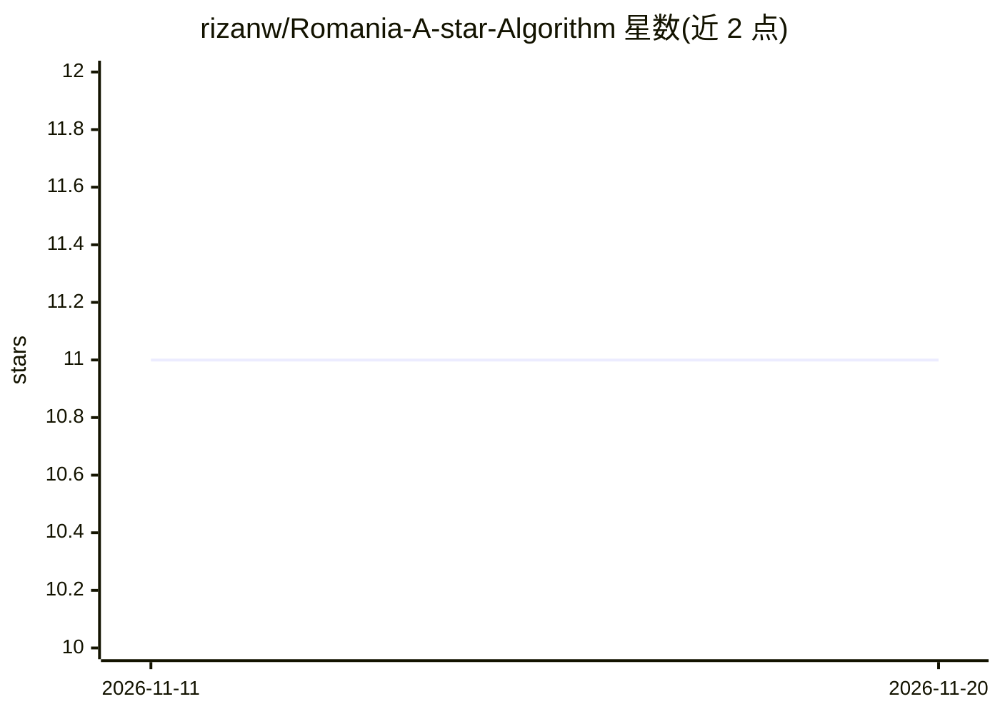

# rizanw/Romania-A-star-Algorithm

⭐ 11 · Python · MIT · 推送 2026-11-11 · [GitHub](https://github.com/rizanw/Romania-A-star-Algorithm) · 个人维护

**AI 课程作业：罗马尼亚地图上的 A* 最短路径搜索**

2019 年为 ITS 人工智能课程编写的教学实现：在《AIMA》经典罗马尼亚路网（20 城 23 条双向道路）上运行 A* 搜索，从任意起点城市找到通往 Bucharest 的最短路线。以直线距离作启发式（可采纳，保证最短），f(n)=g(n)+h(n)，用 heapq 二叉堆作优先队列并维护 closed set。仅依赖 Python 3 标准库，无额外包；地图与启发式数据来自两个文本文件。MIT 许可。

## 筛选速览

| 维度 | 判定 | 备注 |
|---|---|---|
| AI 角色 | `ai-native` | 本体是模型或模型工具 |
| 许可风险 | `permissive` | MIT |
| 部署形态 | `None` |  |
| 模型依赖 | — | README 未给出锁定关系 |
| 硬件要求 | — | 无带数字的原话,不猜 |
| 安装摩擦 | `low` | 无编译、无系统依赖或容器化 |
| 成熟度 | — | 结构信号不足 |

## 能力要点

- 罗马尼亚路网 A* 搜索，启发式为可采纳的直线距离
- heapq 二叉堆优先队列 + closed set，每城至多扩展一次
- 仅依赖 Python 3，无第三方包
- 支持命令行指定起点城市与 --help 列出全部城市

## 适用场景

- 学习 A* 搜索与可采纳启发式的工作原理
- 课程教学中演示 A* 与贪心最佳优先搜索的差异
- 作为图搜索算法的 Python 参考实现

## 场景标签

 · 领域:AI 算法/教育

## 证据(README 行号)

> L3: A* search on the classic Romania road map from *Artificial Intelligence: A Modern Approach* (Russell & Norvig). Give
> L5: Originally written in 2019 for an Artificial Intelligence course at Institut Teknologi Sepuluh Nopember (ITS).
> L24: A* expands cities in order of **f(n) = g(n) + h(n)**:

## 星数曲线

2026-11-11 11 → 2026-11-20 11（+0）

---
*卡片 v1 · prompt 1.4 · 生成 2026-11-18 · 置信度 high · 依据 README sha `c7745b58f9f6` · [字段定义](../../DATASET.md)*
