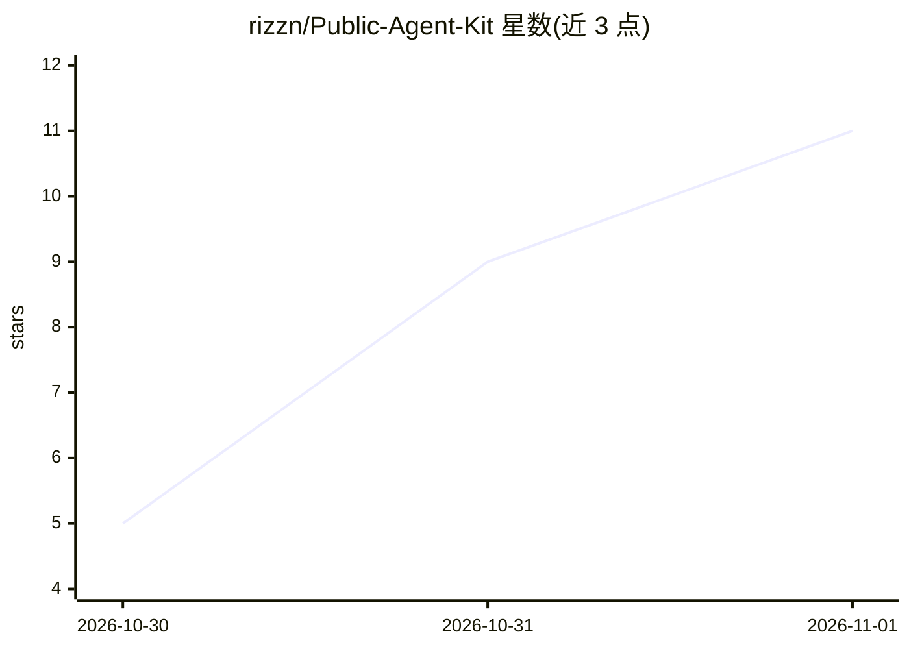

# rizzn/Public-Agent-Kit

⭐ 11 · JavaScript · MIT · 推送 2026-10-28 · [GitHub](https://github.com/rizzn/Public-Agent-Kit) · 个人维护

**给编码 agent 的跨平台技能/规则/钩子集合（PII 防护、变更影响分析等）**

面向 Claude Code、Antigravity、Qwen Code 等编码 agent 的自包含资源仓库：5 个技能（反向依赖与破坏性变更影响分析 blast-radius、yt-dlp 视频/音频下载 mediagrab、XML 提示词扩展 prompt-expansion、字幕或 Groq Whisper 转录 transcribe、网页离线存档 webcopy）、2 条 Markdown 规则（回复格式、工单模板）和 1 个 PII/凭据防护钩子。技能采用 SKILL.md 契约加普通脚本，agent 独立；每个文件夹自包含、无共享代码。限制：mediagrab 与 transcribe 仅限 Windows，二进制不在仓库内由 setup 脚本下载并校验 SHA-256。

## 筛选速览

| 维度 | 判定 | 备注 |
|---|---|---|
| AI 角色 | `ai-ecosystem` | LLM/agent 周边工具 |
| 许可风险 | `permissive` | MIT |
| 部署形态 | `desktop` | 安装包/桌面程序 |
| 模型依赖 | — | README 未给出锁定关系 |
| 硬件要求 | — | 无带数字的原话,不猜 |
| 安装摩擦 | `medium` | 含编译或系统依赖之一 |
| 成熟度 | — | 结构信号不足 |

## 能力要点

- blast-radius 映射反向导入、导出签名变更、断掉的调用点与受影响测试
- pii-guard.js 将工具输出中的邮箱/电话/IBAN/公网 IP 替换为占位符并拦截含 PII 的提示词
- 技能与规则 agent 独立：任何能读 Markdown 并执行 shell 命令的 agent 均可使用
- 每个技能文件夹自包含，无共享代码与外部配置

## 适用场景

- 让我的编码 agent 在改代码前评估变更影响范围
- 给 agent 加装 PII 与凭据读取防护钩子
- 为 agent 统一回复格式与工单书写规则
- 让 agent 下载公开视频或生成带时间戳的转录文本

## 场景标签

`提示工程` `语音识别` `网页抓取` · 领域:Agent 开发

## 证据(README 行号)

> L9: Self-contained **agent skills**, **rules** and **hooks** for coding agents. Skills and rules are
> L12: Hooks depend on each agent's hook protocol; the one here speaks three. Every folder under
> L45: |`pii-guard.js`|Replaces e-mails, phone numbers, IBANs and public IPs in tool output with `[PII:…]` placeholders, b

## 星数曲线

2026-10-30 5 → 2026-11-01 11（+6）

---
*卡片 v1 · prompt 1.4 · 生成 2026-11-01 · 置信度 high · 依据 README sha `3d2ac2510996` · [字段定义](../../DATASET.md)*
