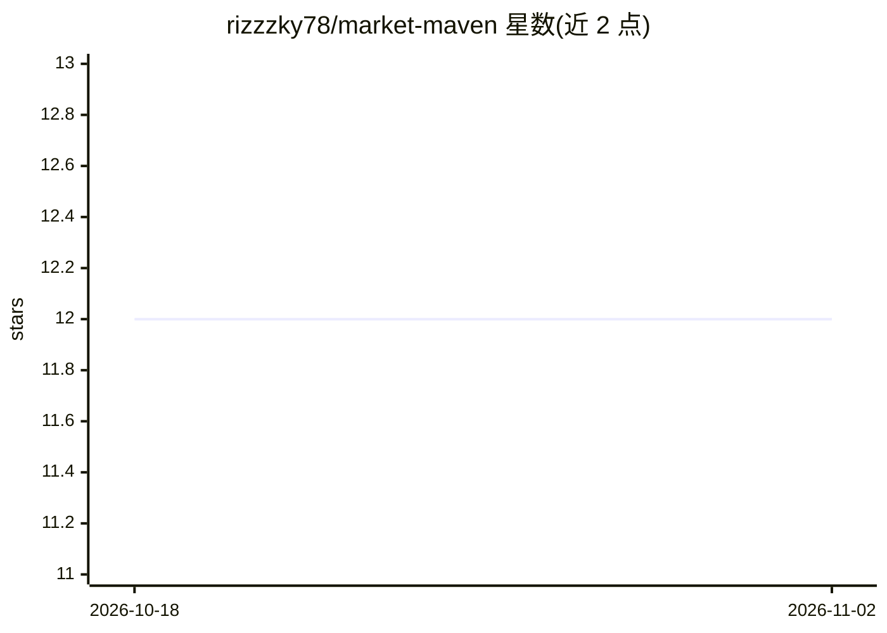

# rizzzky78/market-maven

⭐ 12 · TypeScript · Apache-2.0 · 推送 2026-10-27 · [GitHub](https://github.com/rizzzky78/market-maven) · [官网](https://maven-ai-webpage.vercel.app) · 个人维护

**AI 助手帮你研究、比较和推荐电子产品**

基于 Next.js 的 Web 应用（开发者作品集项目，明确非商用、不供生产使用）：用户以对话方式提出电子产品需求，编排器从六个 agent 工具中选取——个性化推荐、精确搜索、产品详情抓取、双品对比、联网研究、澄清提问——并流式返回结果。数据来自 Firecrawl 网页抓取与 Tavily/Serper 搜索；默认用 Google Gemini（含 Search grounding），用户可切换 OpenAI、Anthropic、OpenRouter 等自带 key 的提供商。支持 OAuth 登录、聊天历史与公开分享链接。需自行部署：Node.js 20+、Bun、PostgreSQL、Upstash Redis，Ubuntu VPS + Nginx + systemd 部署文档齐全。

## 筛选速览

| 维度 | 判定 | 备注 |
|---|---|---|
| AI 角色 | `ai-native` | 本体是模型或模型工具 |
| 许可风险 | `permissive` | Apache-2.0 |
| 部署形态 | `library` | 以包/库形式分发 |
| 模型依赖 | — | README 未给出锁定关系 |
| 硬件要求 | — | 无带数字的原话,不猜 |
| 安装摩擦 | `low` | 无编译、无系统依赖或容器化 |
| 成熟度 | — | 结构信号不足 |

## 能力要点

- 六个 agent 工具：推荐/搜索/详情/对比/联网研究/澄清提问
- 默认 Gemini + Google Search grounding，可切换 10+ 提供商自带 API key
- Firecrawl 抓取 + Tavily/Serper 搜索的外部数据采集，带抓取缓存
- 流式生成 UI、聊天历史、公开只读分享链接

## 适用场景

- 对话式研究笔记本电脑、耳机、手机等电子产品
- 并排对比两款产品并获得要点解读
- 把搜索或对比结果生成公开链接分享

## 场景标签

`AI 助手` · 领域:对话与助手

## 证据(README 行号)

> L13: Maven is a Next.js web application that uses AI to help people research electronics — laptops, headphones, phones, 
> L59: - **AI / orchestration:** Vercel AI SDK 7 (AI SDK UI: `useChat` from `@ai-sdk/react` over a UI message stream for g

## 星数曲线

2026-10-18 12 → 2026-11-02 12（+0）

---
*卡片 v1 · prompt 1.4 · 生成 2026-11-01 · 置信度 mid · 依据 README sha `7897e5ff864f` · [字段定义](../../DATASET.md)*
