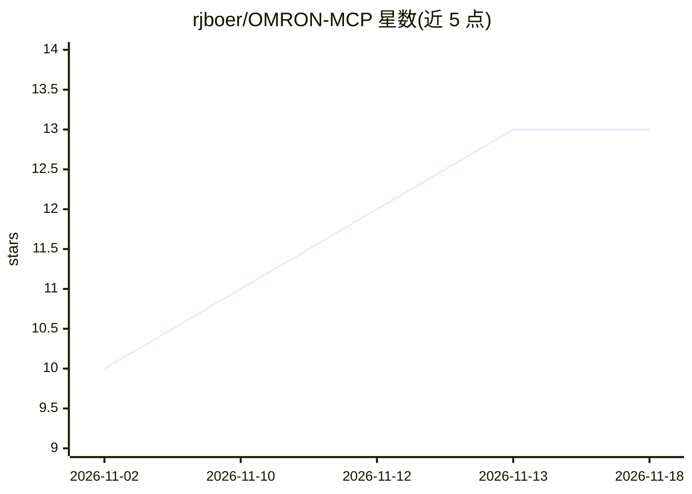

# rjboer/OMRON-MCP

⭐ 13 · Go · AGPL-3.0 · 推送 2026-09-26 · [GitHub](https://github.com/rjboer/OMRON-MCP) · 个人维护

**让 AI 工具读写 OMRON PLC 项目的 MCP 服务器**

Go 编写的 Model Context Protocol 服务器与 Windows workbench，面向 OMRON Sysmac Studio 项目：让支持 MCP 的 AI 客户端检查项目结构、理解 PLC 代码、分析变量、排查故障、生成 Structured Text，并将经审核的变更应用到本机项目。要求有效的 Sysmac Studio 许可证，提供 Windows 可执行文件下载，变更需经工程师审核后在 Sysmac Studio 中验证。

## 筛选速览

| 维度 | 判定 | 备注 |
|---|---|---|
| AI 角色 | `ai-ecosystem` | LLM/agent 周边工具 |
| 许可风险 | `viral` | AGPL-3.0 |
| 部署形态 | `None` |  |
| 模型依赖 | — | README 未给出锁定关系 |
| 硬件要求 | — | 无带数字的原话,不猜 |
| 安装摩擦 | `low` | 无编译、无系统依赖或容器化 |
| 成熟度 | `idea` | |

## 能力要点

- MCP 服务器形式接入 AI 客户端，支持项目检查、代码生成与变更应用
- AI 可基于完整 Sysmac 项目上下文（程序、实体、变量、构建结果）工作
- 提供 Windows 可执行文件与签名发布流程
- 变更须经工程师审核并按正常流程下载到控制器

## 适用场景

- 用 AI 创建和修改 OMRON PLC 程序
- 探索现有 Sysmac 项目的结构与实现细节
- 排查故障并分析变量与项目数据

## 场景标签

`代码生成` · 领域:编码与开发

## 证据(README 行号)

> L10: OMRON MCP is a Go-based Model Context Protocol (MCP) server and Windows workbench for OMRON Sysmac Studio projects.
> L33: 2. Start OMRON MCP using the instructions for your platform and make it available to your AI client. OMRON MCP has 

## 星数曲线

2026-11-02 10 → 2026-11-18 13（+3）

---
*卡片 v1 · prompt 1.4 · 生成 2026-11-18 · 置信度 high · 依据 README sha `10ef5a3d0955` · [字段定义](../../DATASET.md)*
