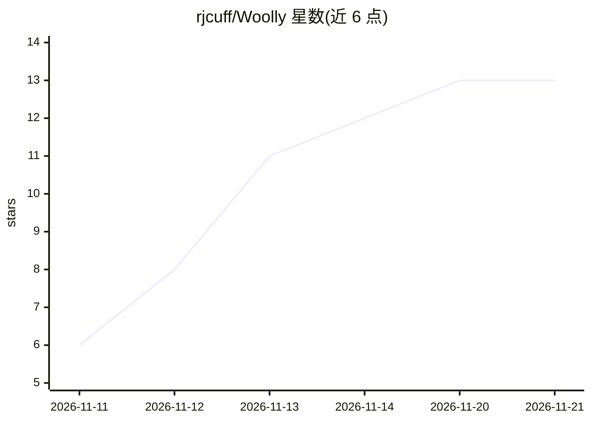

# rjcuff/Woolly

⭐ 13 · Go · MIT · 推送 2026-11-20 · [GitHub](https://github.com/rjcuff/Woolly) · [官网](https://usewoolly.com) · 个人维护

**本地共享的项目记忆服务器：让多个 AI 编码工具共用记忆**

Woolly 为 Claude Code、Cursor、Codex 等编码 agent 提供运行在本机的项目记忆：每条事实指向其来源的文件、函数或行号，代码变更时将依赖该事实的条目标记为 stale 并通过 woolly review 确认或修护；记忆以 Markdown 文件存储、经 git 在团队间共享。支持 woolly proxy 为 Ollama 及 OpenAI/Anthropic 应用提供记忆接口，提供形似 mem0 的 API 及 Python/JavaScript 包，可导入 ChatGPT/Claude 历史记录。无云端、无账户、无遥测；无 Ollama 也可运行，语义搜索需本地模型。

## 筛选速览

| 维度 | 判定 | 备注 |
|---|---|---|
| AI 角色 | `ai-ecosystem` | LLM/agent 周边工具 |
| 许可风险 | `permissive` | MIT |
| 部署形态 | `None` |  |
| 模型依赖 | local-ok | 支持本地模型 |
| 硬件要求 | — | 无带数字的原话,不猜 |
| 安装摩擦 | `low` | 无编译、无系统依赖或容器化 |
| 成熟度 | — | 结构信号不足 |

## 能力要点

- 每条事实引用来源并随代码变更自动标记 stale
- 同一仓库的多个 agent（Claude Code/Cursor/Codex 等）共享一份记忆
- 完全本地运行，记忆为可编辑的 Markdown 文件
- woolly proxy 支持接 Ollama 及 OpenAI/Anthropic 应用

## 适用场景

- 多个编码 agent 切换使用同一仓库时共享项目上下文
- 代码重构后核验记忆中旧事实是否失效
- 团队通过 git 共享技术决策与项目约定

## 场景标签

`Agent 记忆` `语义搜索` · 领域:Agent 开发

## 证据(README 行号)

> L19: Woolly is project memory your coding agents can trust. It runs on your machine, and it knows when a fact goes stale
> L64: - **Memory for the agents you build**, with an API shaped like mem0's and Python and JavaScript packages. Memory AP

## 星数曲线

2026-11-11 6 → 2026-11-21 13（+7）

---
*卡片 v1 · prompt 1.4 · 生成 2026-11-18 · 置信度 high · 依据 README sha `07a79e3da05d` · [字段定义](../../DATASET.md)*
