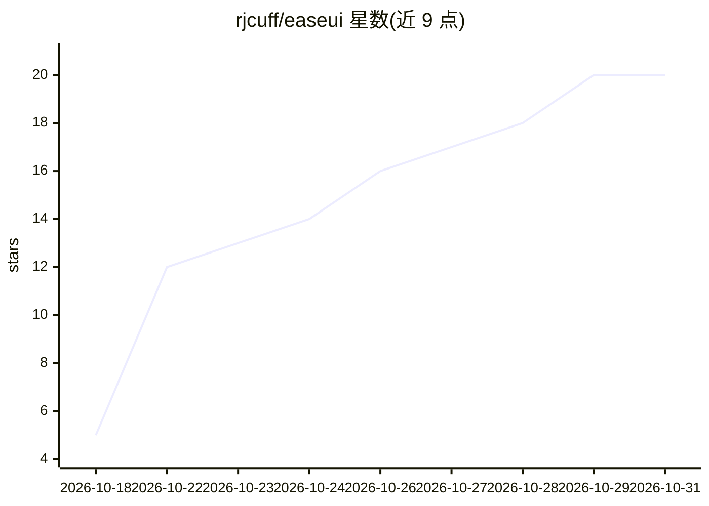

# rjcuff/easeui

⭐ 20 · TypeScript · NOASSERTION · 推送 2026-10-22 · [GitHub](https://github.com/rjcuff/easeui) · [官网](https://easeui.dev) · 个人维护

**带缓动/弹簧动画的 React 组件库，含 AI 界面组件**

通过 shadcn CLI 以源码文件形式安装的 React 组件库，基于 React 19 与 Tailwind CSS 4，MIT 许可。组件分两类：通用界面组件（按钮、命令面板、OTP 输入等）与面向 AI 界面的 Agents 类（消息气泡、流式文本、推理披露、工具审批、任务列表等）。动画限定 transform/opacity、100-300ms 时长并响应系统的减弱动态偏好。另提供 MCP 服务器与 skill，使 Claude Code、Cursor、Codex 等编码代理可检索并安装组件；另有付费的 easeUI Pro 组件集。

## 筛选速览

| 维度 | 判定 | 备注 |
|---|---|---|
| AI 角色 | `ai-enhanced` | 去掉 AI 部分产品仍成立 |
| 许可风险 | `none` | NOASSERTION |
| 部署形态 | `library` | 以包/库形式分发 |
| 模型依赖 | — | README 未给出锁定关系 |
| 硬件要求 | — | 无带数字的原话,不猜 |
| 安装摩擦 | `low` | 无编译、无系统依赖或容器化 |
| 成熟度 | — | 结构信号不足 |

## 能力要点

- 以源码文件经 shadcn CLI 安装，可读可改（@easeui 命名空间或 registry URL）
- Agents 类组件：消息气泡、流式文本、推理披露、工具审批、任务列表
- 动画遵循固定规则：transform/opacity、100-300ms、支持 reduced-motion
- 提供 MCP 服务器与 skill 供编码代理检索安装组件

## 适用场景

- 在 React + Tailwind 项目中加入动效统一的界面组件
- 构建聊天/Agent 界面时复用流式消息、工具审批等组件
- 让 Claude Code/Cursor 等编码代理按需查找并安装本库组件

## 场景标签

 · 领域:前端/UI 组件库

## 证据(README 行号)

> L42: |**Components**|Buttons, inputs and overlays, plus feedback like toasts and alerts. Includes a command palette, OTP
> L43: |**Agents**|Pieces for AI interfaces. A message bubble, streaming text and responses, a reasoning disclosure, loadi

## 星数曲线

2026-10-18 5 → 2026-10-31 20（+15）

---
*卡片 v1 · prompt 1.4 · 生成 2026-10-29 · 置信度 high · 依据 README sha `4a6e1c73343d` · [字段定义](../../DATASET.md)*
