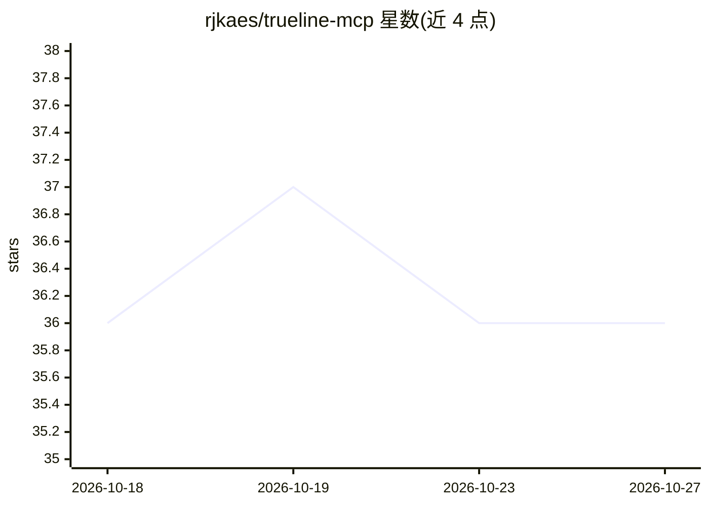

# rjkaes/trueline-mcp

⭐ 36 · TypeScript · Apache-2.0 · 推送 2026-10-01 · [GitHub](https://github.com/rjkaes/trueline-mcp) · 个人维护

**给 AI 编码代理的 MCP 插件：省 token 的定向读取与哈希校验编辑**

面向 AI 编码代理的 MCP 工具插件，提供 6 个工具：AST 结构大纲、按行区间读取、正则/字面量搜索、紧凑编辑、语义 diff 与引用校验。编辑以行区间加内容哈希替代回显旧文本，文件被并发修改或内容不匹配时拒绝写入。通过 hooks 拦截内置读取/编辑工具（大于 3KB 文件重定向读取、阻止未校验编辑），支持 Claude Code、Gemini CLI、VS Code Copilot、OpenCode、Codex CLI。安全模型为单用户文件系统信任，路径校验防目录穿越与符号链接逃逸，TOCTOU 竞态不在处理范围内。

## 筛选速览

| 维度 | 判定 | 备注 |
|---|---|---|
| AI 角色 | `ai-ecosystem` | LLM/agent 周边工具 |
| 许可风险 | `permissive` | Apache-2.0 |
| 部署形态 | `library` | 以包/库形式分发 |
| 模型依赖 | — | README 未给出锁定关系 |
| 硬件要求 | — | 无带数字的原话,不猜 |
| 安装摩擦 | `low` | 无编译、无系统依赖或容器化 |
| 成熟度 | — | 结构信号不足 |

## 能力要点

- AST 大纲 + 行区间读取，减少上下文消耗
- 内容哈希校验编辑，不匹配即拒绝落盘
- 多编辑可单次调用批量原子应用
- hooks 拦截内置工具，按平台校准指令（Claude Code 下依从率约 98%）

## 适用场景

- 让编码代理在大文件/多文件编辑中节省 token 与 API 开销
- 防止代理因陈旧上下文或幻觉内容静默破坏代码
- 用语义 diff 审查相对 git ref 的结构性变更

## 场景标签

`编码 Agent` · 领域:编码与开发

## 证据(README 行号)

> L5: An MCP plugin that gives AI coding agents
> L41: trueline provides six MCP tools organized around three workflows.

## 星数曲线

2026-10-18 36 → 2026-10-27 36（+0）

---
*卡片 v1 · prompt 1.4 · 生成 2026-10-25 · 置信度 high · 依据 README sha `87e22f11838c` · [字段定义](../../DATASET.md)*
