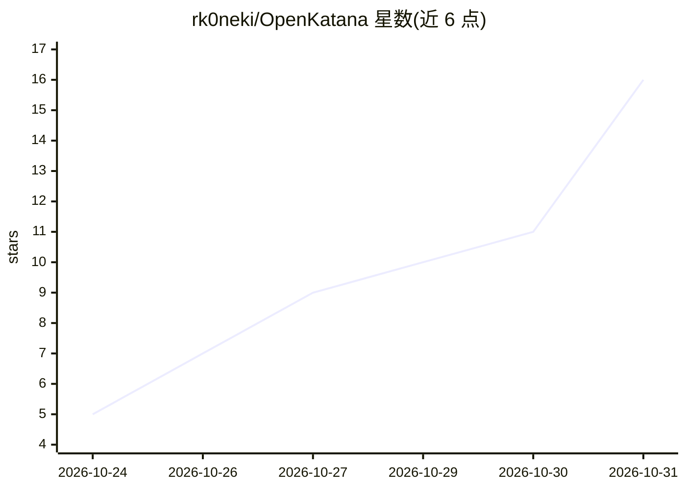

# rk0neki/OpenKatana

⭐ 16 · Python · Apache-2.0 · 推送 2026-10-29 · [GitHub](https://github.com/rk0neki/OpenKatana) · 个人维护

**给创作者与 AI agent 的开源代码化视频剪辑引擎**

以代码驱动剪辑的开源引擎：用户向 AI agent 提供素材与意图，agent 通过 72 个 CLI/MCP 工具编排镜头、编写场景/动画代码并构建时间线，本地渲染生成成品剪辑（剪辑、转场、运动图形、3D WebGL 场景、音频混合与导出）。提供 Studio 图形界面、ComfyUI Apps（85 节点）、CLI 与可选 MCP 四种入口，共享同一工程。标准剪辑渲染无需专用 GPU，生成能力依赖另行安装或授权的模型；Blender 与生成模型为可选，macOS 未测试。

## 筛选速览

| 维度 | 判定 | 备注 |
|---|---|---|
| AI 角色 | `ai-enhanced` | 去掉 AI 部分产品仍成立 |
| 许可风险 | `permissive` | Apache-2.0 |
| 部署形态 | `None` |  |
| 模型依赖 | — | README 未给出锁定关系 |
| 硬件要求 | — | 无带数字的原话,不猜 |
| 安装摩擦 | `medium` | 含编译或系统依赖之一 |
| 成熟度 | — | 结构信号不足 |

## 能力要点

- 72 个 CLI/MCP 工具供 agent 编排剪辑，工程保留在本地可编辑
- Studio、ComfyUI Apps（85 节点）、CLI、MCP 共享同一项目
- 代码编写 WebGL 3D 场景，可选 Blender 渲染流程
- 本地免费使用，标准工作流无需专用 GPU

## 适用场景

- 让 AI agent 把照片、素材与音乐编排成成品视频
- 在 ComfyUI 中用节点图串联本地模型输出与剪辑流程
- 剪辑后进入 Studio 手动审阅并精修，再导出成片

## 场景标签

`视频生成` · 领域:内容生成

## 证据(README 行号)

> L104: OpenKatana offers **72 CLI/MCP tools** (see them all). Your agent supplies the creative
> L161: **Can I use it in ComfyUI without an agent?** Yes, through the Apps.

## 星数曲线

2026-10-24 5 → 2026-10-31 16（+11）

---
*卡片 v1 · prompt 1.4 · 生成 2026-10-30 · 置信度 high · 依据 README sha `ff8eac9c1847` · [字段定义](../../DATASET.md)*
