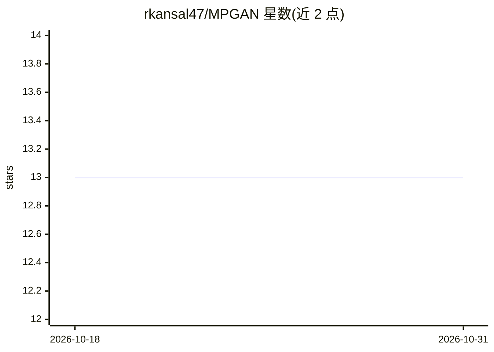

# rkansal47/MPGAN

⭐ 13 · Python · MIT · 推送 2026-10-05 · [GitHub](https://github.com/rkansal47/MPGAN) · 个人维护

**物理学者/科研：生成高能物理粒子云的 GAN 与 Transformer 模型**

PyTorch 实现的消息传递 GAN（MPGAN，NeurIPS 2021）与生成对抗粒子 Transformer（GAPT），用于高能物理中的粒子云（喷注）生成。提供训练脚本、生成与绘图脚本，并附带论文中完全训练好的模型权重；另发布独立的 JetNet 库，提供 JetNet 数据集的 PyTorch Dataset 类、论文中的评测指标实现及开发工具。依赖 torch>=1.8.0、jetnet、numpy 等，可用 pip 安装 requirements 或使用提供的 Docker 镜像，GPU 可用时默认在 GPU 上训练。

## 筛选速览

| 维度 | 判定 | 备注 |
|---|---|---|
| AI 角色 | `ai-native` | 本体是模型或模型工具 |
| 许可风险 | `permissive` | MIT |
| 部署形态 | `self-host` | docker 或自建部署 |
| 模型依赖 | — | README 未给出锁定关系 |
| 硬件要求 | — | 无带数字的原话,不猜 |
| 安装摩擦 | `low` | 无编译、无系统依赖或容器化 |
| 成熟度 | — | 结构信号不足 |

## 能力要点

- MPGAN 与 GAPT 两种粒子云生成模型实现
- 附带论文中完全训练好的模型权重，可用 gen.py 直接生成样本
- JetNet 库提供数据集类与评测指标实现
- 支持在稀疏化 MNIST 点云数据集上原型训练

## 适用场景

- 训练或微调粒子喷注生成模型
- 用预训练生成器批量生成粒子云样本
- 高能物理生成模型的评测研究

## 场景标签

`科研工具` `模型训练` · 领域:学习与行业

## 证据(README 行号)

> L15: This repository contains PyTorch code for the message-passing GAN (MPGAN) and generative adversarial particle trans
> L16: We include also weights of fully trained models discussed in [2].

## 星数曲线

2026-10-18 13 → 2026-10-31 13（+0）

---
*卡片 v1 · prompt 1.4 · 生成 2026-10-31 · 置信度 high · 依据 README sha `8ba743ce7c1b` · [字段定义](../../DATASET.md)*
