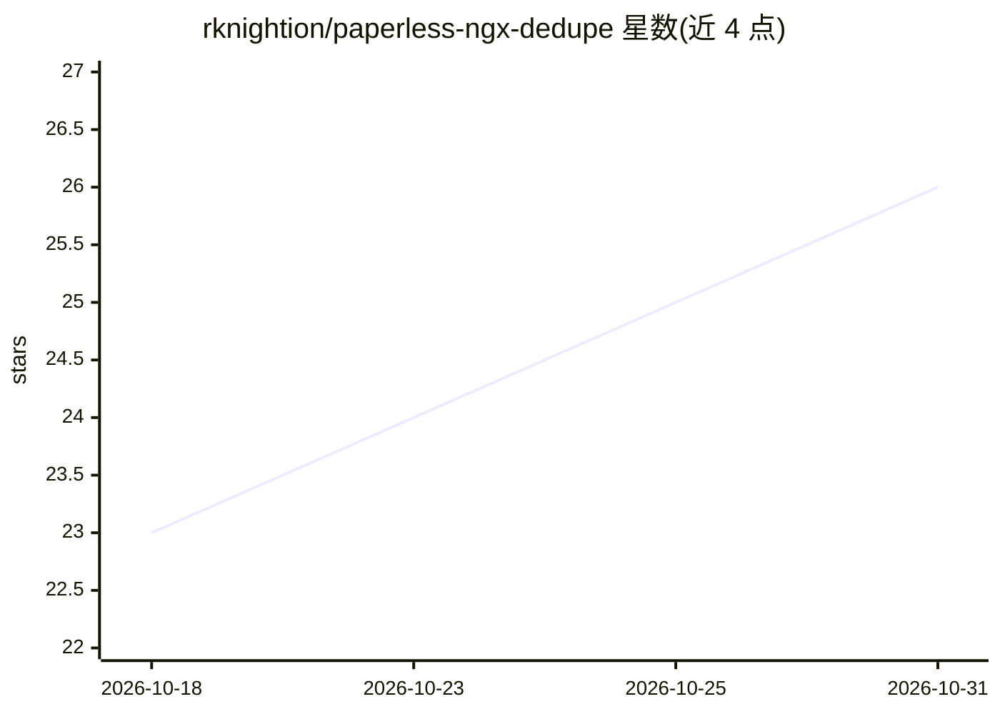

# rknightion/paperless-ngx-dedupe

⭐ 26 · TypeScript · GPL-3.0 · 推送 2026-10-30 · [GitHub](https://github.com/rknightion/paperless-ngx-dedupe) · [官网](https://m7kni.io/paperless-ngx-dedupe/) · 个人维护

**Paperless-NGX 文档去重与 AI 元数据提取配套工具**

面向 Paperless-NGX 用户的文档去重与元数据管理服务：从 Paperless-NGX 实例全量或增量同步文档，用 MinHash/LSH 加加权 Jaccard 相似度检测精确哈希无法发现的近似重复文档，提供并排对比、OCR 文本差异与批量处置的 Web UI 和 REST API。AI 部分为可选项：调用 OpenAI 模型从文档文本提取往来单位、文档类型与标签，附逐字段置信度与证据片段。以单个 Docker 容器交付，内嵌 SQLite，无需外部依赖。

## 筛选速览

| 维度 | 判定 | 备注 |
|---|---|---|
| AI 角色 | `ai-enhanced` | 去掉 AI 部分产品仍成立 |
| 许可风险 | `viral` | GPL-3.0 |
| 部署形态 | `self-host` | docker 或自建部署 |
| 模型依赖 | — | README 未给出锁定关系 |
| 硬件要求 | — | 无带数字的原话,不猜 |
| 安装摩擦 | `low` | 无编译、无系统依赖或容器化 |
| 成熟度 | — | 结构信号不足 |

## 能力要点

- MinHash + LSH 近似重复检测，含打压样板文本的惩罚项
- 并排对比、OCR 文本差异与批量审核/删除重复文档
- OpenAI 模型提取 correspondents/tags/文档类型，带置信度与证据片段
- 单容器部署，内嵌 SQLite，提供 OpenTelemetry 可观测性

## 适用场景

- 清理 Paperless-NGX 文档库中的重复或近似重复文档
- 用 AI 自动为新旧文档补齐标签、类型和往来单位
- 通过 REST API 批量处置重复文档并导出 CSV 报告

## 场景标签

 · 领域:文档管理/工具

## 证据(README 行号)

> L5: A document deduplication and AI-powered metadata companion for Paperless-NGX. It syncs your documents, identifies du
> L17: - **Automatic classification** -- extract correspondents, document types, and tags from document text using OpenAI 

## 星数曲线

2026-10-18 23 → 2026-10-31 26（+3）

---
*卡片 v1 · prompt 1.4 · 生成 2026-10-26 · 置信度 high · 依据 README sha `8dc0281830de` · [字段定义](../../DATASET.md)*
