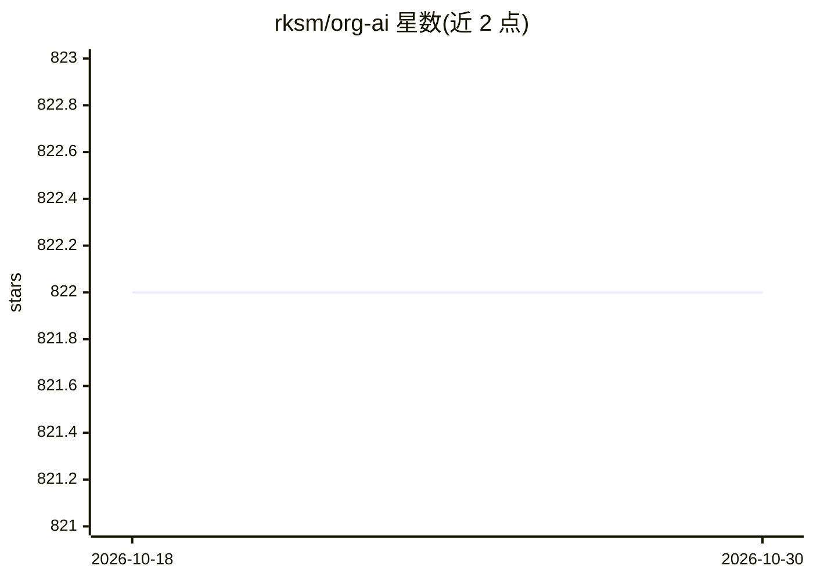

# rksm/org-ai

⭐ 822 · Emacs Lisp · GPL-3.0 · 推送 2026-01-07 · [GitHub](https://github.com/rksm/org-ai) · 个人维护

**Emacs org-mode 的生成式 AI 副模式：文本/图像生成与语音输入输出**

org-mode 的 Emacs minor mode，通过 #+begin_ai 代码块调用生成式 AI：OpenAI API（ChatGPT、DALL-E 及补全模型，可选 Azure 端点）、经 stable-diffusion-webui 的 Stable Diffusion、经 oobabooga/text-generation-webui 的本地模型。块内可控制系统提示、温度等参数，支持图像尺寸/数量设定、img2img、CLIP/DeepDanbooru 提示词反推、语音转录输入与语音输出。另提供全局命令在 org-mode 外做选区问答、摘要、代码重构与多文件批量修改。使用 OpenAI 需 API token。

## 筛选速览

| 维度 | 判定 | 备注 |
|---|---|---|
| AI 角色 | `ai-native` | 本体是模型或模型工具 |
| 许可风险 | `viral` | GPL-3.0 |
| 部署形态 | `self-host` | docker 或自建部署 |
| 模型依赖 | locked-api |  |
| 硬件要求 | — | 无带数字的原话,不猜 |
| 安装摩擦 | `low` | 无编译、无系统依赖或容器化 |
| 成熟度 | — | 结构信号不足 |

## 能力要点

- org 代码块内调用 ChatGPT/DALL-E/Stable Diffusion/本地模型生成文本与图像
- 语音输入（转录）与语音输出
- org-mode 外的全局命令：选区问答、摘要、代码重构、多文件批量修改
- 通过 oobabooga text-generation-webui 支持 :local 本地模型请求

## 适用场景

- 在 org 笔记中直接与 ChatGPT 对话或生成文档内容
- 用文本提示生成 DALL-E/Stable Diffusion 图像并插入笔记
- 让 AI 对选中文本做摘要或重构代码
- 用语音向 AI 提问并听取回答

## 场景标签

`代码生成` `图像生成` `AI 写作` · 领域:编码与开发

## 证据(README 行号)

> L5: Minor mode for Emacs org-mode that provides access to generative AI models. Currently supported are
> L10: - use ChatGPT to generate text, having full control over system and user prompts (demo)
> L12: - generate images and image variations with a text prompt using Stable Diffusion or DALL-E (demo 1, demo 2)

## 星数曲线

2026-10-18 822 → 2026-10-30 822（+0）

---
*卡片 v1 · prompt 1.4 · 生成 2026-10-21 · 置信度 mid · 依据 README sha `98d5686d0ffa` · [字段定义](../../DATASET.md)*
