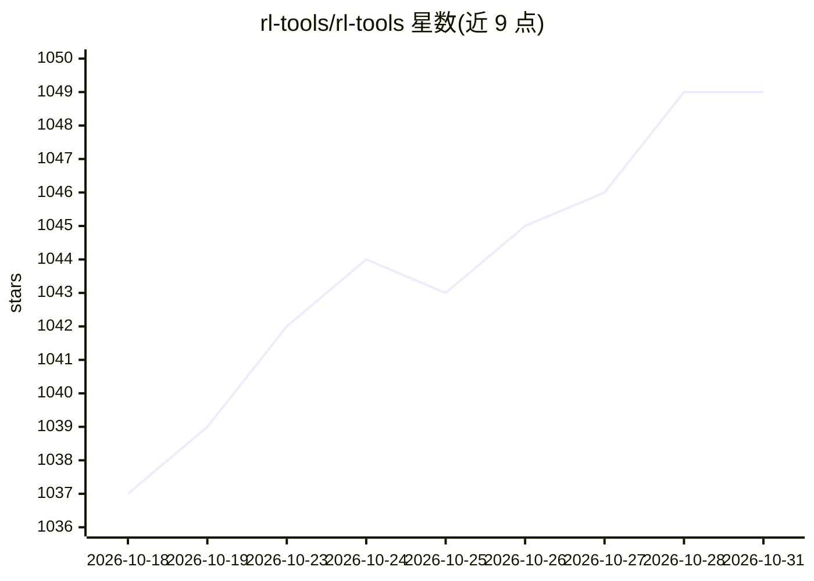

# rl-tools/rl-tools

⭐ 1,049 · C++ · MIT · 推送 2026-10-29 · [GitHub](https://github.com/rl-tools/rl-tools) · [官网](https://rl.tools) · 组织维护

**面向连续控制的 C++ 深度强化学习库，支持嵌入式部署**

以 C++17 头文件/模板实现的深度强化学习库，实现 TD3、PPO、SAC、Multi-Agent PPO 等算法，覆盖 Pendulum、MuJoCo Ant 等连续控制环境。提供 Python 绑定（PyPI 包 rltools，可搭配 Gymnasium 环境）。支持 CPU 加速后端（macOS Accelerate、Ubuntu OpenBLAS）与 CUDA 训练，并可运行于 iOS、Teensy、ESP32、Crazyflie、PX4 等嵌入式平台做推理乃至训练。文档以 C++ notebook 形式提供，可 Docker 运行。注意使用 Python Gym 环境相对原生环境会显著拖慢训练。

## 筛选速览

| 维度 | 判定 | 备注 |
|---|---|---|
| AI 角色 | `ai-native` | 本体是模型或模型工具 |
| 许可风险 | `permissive` | MIT |
| 部署形态 | `self-host` | docker 或自建部署 |
| 模型依赖 | — | README 未给出锁定关系 |
| 硬件要求 | — | 无带数字的原话,不猜 |
| 安装摩擦 | `low` | 无编译、无系统依赖或容器化 |
| 成熟度 | — | 结构信号不足 |

## 能力要点

- 实现 TD3/PPO/SAC/Multi-Agent PPO 等连续控制算法
- 支持嵌入式平台（ESP32、Teensy、Crazyflie、PX4、iOS）推理与训练
- 提供 Python 绑定并通过 PyPI 发布
- 文档以 C++ notebook 提供，可 Docker 或 Binder 运行

## 适用场景

- 训练机器人/四旋翼等连续控制任务的策略
- 在微控制器等嵌入式设备上运行 RL 推理
- 用 Python 接口在 Gymnasium 环境中做强化学习实验

## 场景标签

`强化学习` · 领域:训练与推理

## 证据(README 行号)

> L62: ## Algorithms
> L116: ## Embedded Platforms

## 星数曲线

2026-10-18 1,037 → 2026-10-31 1,049（+12）

---
*卡片 v1 · prompt 1.4 · 生成 2026-10-21 · 置信度 high · 依据 README sha `ca73c453671c` · [字段定义](../../DATASET.md)*
