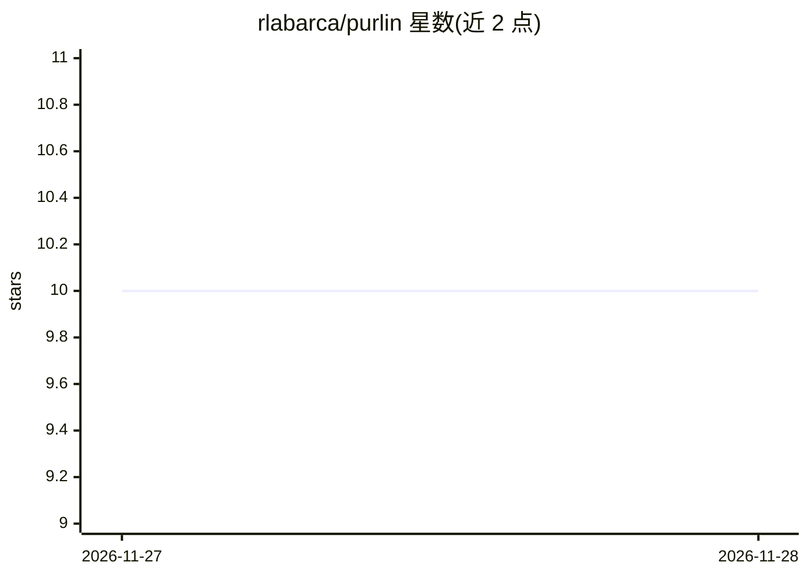

# rlabarca/purlin

⭐ 10 · Python · MIT · 推送 2026-11-18 · [GitHub](https://github.com/rlabarca/purlin) · 个人维护

**Claude Code 插件：逐条规则核验 AI 代码是否满足需求**

以 Claude Code 插件形式提供的规格驱动开发工具。用户在 specs/ 下以 Markdown 规则书写需求，测试上方一条注释将测试与规则绑定；插件运行用户自己的测试命令，逐条报告规则通过情况，并在仓库中留存测试证据与人工签核两个事实。支持植入 bug 审计测试有效性、测试提示词/技能、签核证据包与漂移报告。前提条件为 git、Python 3.9+ 与 Claude Code；仅面向 Claude Code 用户，自身不声称合规或正确性证明。

## 筛选速览

| 维度 | 判定 | 备注 |
|---|---|---|
| AI 角色 | `ai-ecosystem` | LLM/agent 周边工具 |
| 许可风险 | `permissive` | MIT |
| 部署形态 | `None` |  |
| 模型依赖 | — | README 未给出锁定关系 |
| 硬件要求 | — | 无带数字的原话,不猜 |
| 安装摩擦 | `low` | 无编译、无系统依赖或容器化 |
| 成熟度 | — | 结构信号不足 |

## 能力要点

- 需求写成规则，测试以一条注释绑定规则，运行自有测试命令逐条报告
- 仓库内留存测试证据与人工签核（Tests / Sign-off 两个事实）
- purlin:audit 为每条 proof 植入 bug，检验测试能否捕获
- 支持对提示词/技能按指定模型测试，可由第二个模型评分

## 适用场景

- 逐条需求核验 AI 生成的代码是否按规格实现
- 在监管环境中将证据包交给文档管控系统并做人工签核
- 为没有规格的存量代码库反向生成规格
- 检测合并/变基后规则、proof 与测试的漂移

## 场景标签

`代码审查` · 领域:编码与开发

## 证据(README 行号)

> L5: Purlin is a Claude Code plugin for spec-driven development. It shows, rule by rule, that your
> L9: runs your own test command and tells you which rules pass on the code as it is now.
> L21: Agentic developers using Claude Code that need proof their AI-written code does what was asked,

## 星数曲线

2026-11-27 10 → 2026-11-28 10（+0）

---
*卡片 v1 · prompt 1.4 · 生成 2026-11-27 · 置信度 high · 依据 README sha `4a3941e348eb` · [字段定义](../../DATASET.md)*
