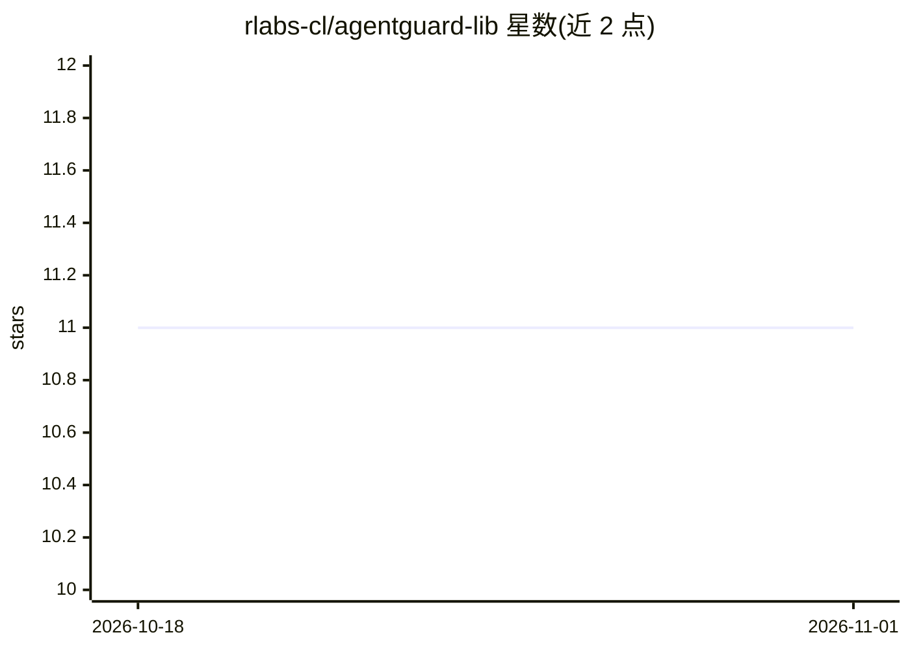

# rlabs-cl/agentguard-lib

⭐ 11 · Python · MIT · 推送 2026-04-24 · [GitHub](https://github.com/rlabs-cl/agentguard-lib) · 个人维护

**给 AI 编程 agent 的代码生成质量框架 MCP 服务器**

AgentGuard 是一个 MCP 服务器，为 Claude、GPT、Gemini 等 AI 编程 agent 提供结构化代码生成流程：骨架→契约与接线→逐函数实现→自审→静态校验五个阶段，附带 skeleton、validate、migrate 等 20 余个工具和 8 个内置项目原型（archetype），另可通过 Marketplace 安装 61 个社区原型。它自身不调用任何 LLM，只返回结构化提示与标准，无需 API key。通过 pip 安装，配置到 Claude Desktop/Code、Cursor、Windsurf 或以 stdio 方式直接运行。

## 筛选速览

| 维度 | 判定 | 备注 |
|---|---|---|
| AI 角色 | `ai-ecosystem` | LLM/agent 周边工具 |
| 许可风险 | `permissive` | MIT |
| 部署形态 | `library` | 以包/库形式分发 |
| 模型依赖 | — | README 未给出锁定关系 |
| 硬件要求 | — | 无带数字的原话,不猜 |
| 安装摩擦 | `low` | 无编译、无系统依赖或容器化 |
| 成熟度 | — | 结构信号不足 |

## 能力要点

- 五阶段代码生成流程（骨架/契约/逻辑/自审/校验）
- 自身不调用 LLM，无需 API key
- 8 个内置原型 + 61 个社区原型可扩展
- 提供 20 余个 MCP 工具含 validate 静态检查与 migrate 迁移计划

## 适用场景

- 让 AI agent 按结构化流程生成生产级代码
- 约束 agent 避免幻觉 import 与不一致架构
- 为不同技术栈选用项目原型并做迁移规划

## 场景标签

`代码生成` `提示工程` · 领域:Agent 开发

## 证据(README 行号)

> L9: > Agent-native quality engine for LLM code generation.
> L36: AgentGuard is an MCP server that gives your AI agent (Claude, GPT, Gemini, etc.) a disciplined process for generati

## 星数曲线

2026-10-18 11 → 2026-11-01 11（+0）

---
*卡片 v1 · prompt 1.4 · 生成 2026-11-01 · 置信度 high · 依据 README sha `4c3ad6fa5098` · [字段定义](../../DATASET.md)*
