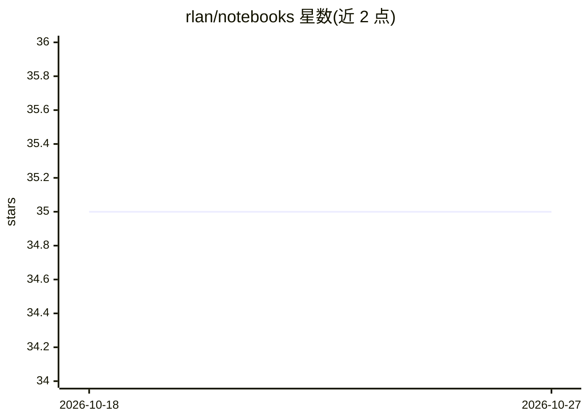

# rlan/notebooks

⭐ 35 · Dockerfile · MIT · 推送 2025-11-17 · [GitHub](https://github.com/rlan/notebooks) · [官网](https://hub.docker.com/r/wqael/notebooks/) · 个人维护

**Docker 化的 Jupyter 机器学习运行环境启动套件**

基于 Docker 的机器学习起步套件，为希望直接获得可用运行环境的用户提供预构建镜像：镜像覆盖 PyTorch、TensorFlow/Keras 框架与 CUDA 8 至 13 多代 GPU 环境组合，内置 JupyterLab、scikit-learn、pandas、matplotlib、OpenCV、NLTK 等常用库。使用流程为 docker pull 拉取镜像、docker run（GPU 需 nvidia-docker）挂载本地 notebook 目录并在浏览器中以 token 登录。不设 latest 标签，需自选具体版本 tag；Python 2 已弃用，部分旧 tag 标记为 deprecated。

## 筛选速览

| 维度 | 判定 | 备注 |
|---|---|---|
| AI 角色 | `ai-ecosystem` | LLM/agent 周边工具 |
| 许可风险 | `permissive` | MIT |
| 部署形态 | `self-host` | docker 或自建部署 |
| 模型依赖 | — | README 未给出锁定关系 |
| 硬件要求 | `cpu-ok` | |
| 安装摩擦 | `low` | 无编译、无系统依赖或容器化 |
| 成熟度 | — | 结构信号不足 |

## 能力要点

- 镜像覆盖 PyTorch / TensorFlow(Keras) 框架与多代 CUDA 组合
- 内置 JupyterLab、scikit-learn、pandas、matplotlib、OpenCV、NLTK
- docker pull + docker run 两步启动，GPU 需 nvidia-docker
- 每个 GPU tag 标注最低 Nvidia 驱动版本要求

## 适用场景

- 快速获得开箱即用的机器学习 Jupyter 运行环境
- 在特定 CUDA/框架版本组合下复现实验环境
- 本地挂载 notebook 目录进行开发与训练

## 场景标签

 · 领域:机器学习/开发环境

## 证据(README 行号)

> L7: A docker-based starter kit for machine learning via jupyter notebooks. Designed for those who just want a runtime en
> L14: * machine learning frameworks (Keras, TensorFlow, PyTorch)

## 星数曲线

2026-10-18 35 → 2026-10-27 35（+0）

---
*卡片 v1 · prompt 1.4 · 生成 2026-10-25 · 置信度 high · 依据 README sha `911afeed2024` · [字段定义](../../DATASET.md)*
