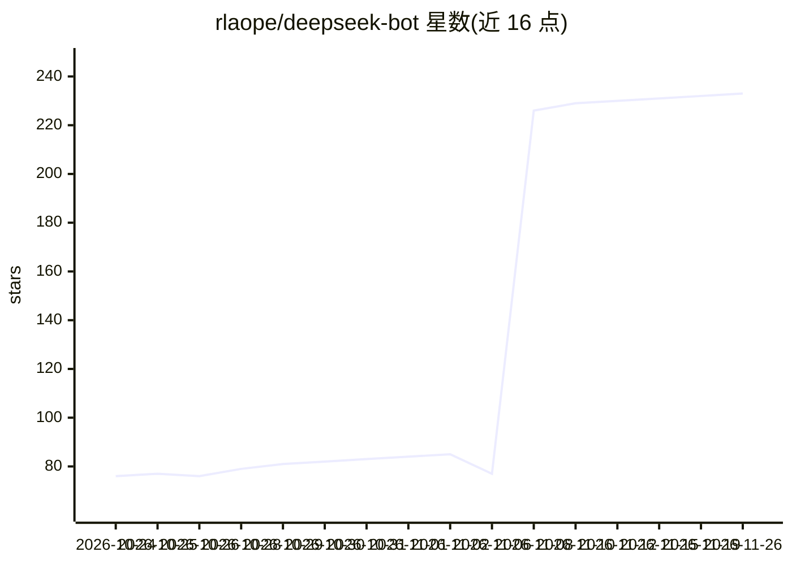

# rlaope/deepseek-bot

⭐ 233 · TypeScript · MIT · 推送 2026-11-23 · [GitHub](https://github.com/rlaope/deepseek-bot) · 个人维护

**跨会话记忆的终端与 Slack/Discord/Telegram DeepSeek Agent**

DeepSeek Harness 的插件：提供一个常驻 Agent，跨对话保存记忆（USER.md/MEMORY.md/会话索引），可在全屏终端（dsh）以及 Slack、Discord、Telegram 中被 @ 提问。命令在 macOS Seatbelt 沙箱中运行，删除/覆盖类操作需对话内 Allow/Deny 确认；默认使用 DeepSeek 官方 API，也可选 OpenGateway 等 OpenAI 兼容端点。依赖 Node.js 22+ 与 DeepSeek Harness 应用；Windows 仅支持手动运行终端，安装器、服务与沙箱未移植。

## 筛选速览

| 维度 | 判定 | 备注 |
|---|---|---|
| AI 角色 | `ai-native` | 本体是模型或模型工具 |
| 许可风险 | `permissive` | MIT |
| 部署形态 | `None` |  |
| 模型依赖 | locked-api |  |
| 硬件要求 | — | 无带数字的原话,不猜 |
| 安装摩擦 | `low` | 无编译、无系统依赖或容器化 |
| 成熟度 | — | 结构信号不足 |

## 能力要点

- dsh 全屏终端界面：流式回答、工具调用 diff 展示，可写 docx/xlsx/pptx、读链接与图片、使用 MCP 工具
- 持久化记忆：会话跨重启留存，带 recall 索引，每轮注入 persona 与用户/工作记录
- 对话内审批机制：破坏性命令等待 Allow/Deny
- Seatbelt 沙箱限制写入范围，提示注入文本在模型看到前被标记

## 适用场景

- 在终端里拥有一个记得上下文的持续 AI 助手
- 在 Slack/Discord/Telegram 群聊中 @ 机器人获取回答
- 让 Agent 在沙箱中执行文件读写等命令并逐条确认危险操作

## 场景标签

`AI 助手` `聊天机器人` `Agent 记忆` · 领域:Agent 开发

## 证据(README 行号)

> L12: **deepseek-bot** is a plugin for DeepSeek Harness.
> L13: One always-on agent that remembers across conversations, in your terminal, Slack, Discord and Telegram.

## 星数曲线

2026-10-24 76 → 2026-11-26 233（+157）

---
*卡片 v1 · prompt 1.4 · 生成 2026-11-25 · 置信度 high · 依据 README sha `d2917757c83b` · [字段定义](../../DATASET.md)*
