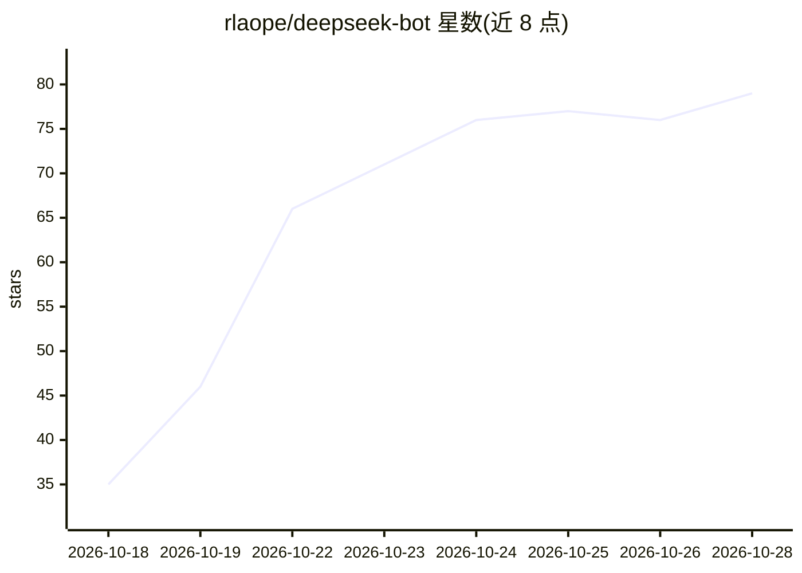

# rlaope/deepseek-bot

⭐ 81 · TypeScript · MIT · 推送 2026-10-28 · [GitHub](https://github.com/rlaope/deepseek-bot) · 个人维护

**自托管个人 AI 队友：常驻 Slack/Discord/Telegram 与终端**

基于 DeepSeek Harness 构建的常驻个人 agent，以 bot 形式接入 Slack、Discord、Telegram 并提供终端 TUI。它会记忆跨重启的会话线程、读取链接与图片、生成 docx/xlsx/pptx 并上传、执行破坏性操作前请求批准；命令运行在仅可写自身工作区的沙箱中。人设与笔记以 Markdown 文件维护。macOS 上以 launchd 服务运行（Windows 仅部分功能可用）。通过 curl 安装脚本安装，需 Node.js 22+ 与 DeepSeek API key。

## 筛选速览

| 维度 | 判定 | 备注 |
|---|---|---|
| AI 角色 | `ai-native` | 本体是模型或模型工具 |
| 许可风险 | `permissive` | MIT |
| 部署形态 | `None` |  |
| 模型依赖 | locked-api |  |
| 硬件要求 | — | 无带数字的原话,不猜 |
| 安装摩擦 | `low` | 无编译、无系统依赖或容器化 |
| 成熟度 | — | 结构信号不足 |

## 能力要点

- Slack/Discord/Telegram 网关接入，同一 agent 另有终端 TUI
- 线程记忆跨重启持久，人设与笔记为可编辑的 Markdown 文件
- 破坏性操作需人工批准，命令运行于受限沙箱
- 生成 docx/xlsx/pptx 并上传，读取链接与图片

## 适用场景

- 在团队已有的 Slack/Discord/Telegram 频道里直接 @ 它提问
- 让它代写报告文档并回传到会话
- 设置定时监视与提醒（watch/reminder）

## 场景标签

`AI 助手` `聊天机器人` · 领域:对话与助手

## 证据(README 行号)

> L5:  An always-on AI teammate for Slack, Discord and Telegram, built on DeepSeek Harness.
> L68: **It lives where your team already talks.** Mention it in a Slack channel, a Discord server or a

## 星数曲线

2026-10-18 35 → 2026-10-28 79（+44）

---
*卡片 v1 · prompt 1.4 · 生成 2026-10-24 · 置信度 high · 依据 README sha `fe64d761e848` · [字段定义](../../DATASET.md)*
