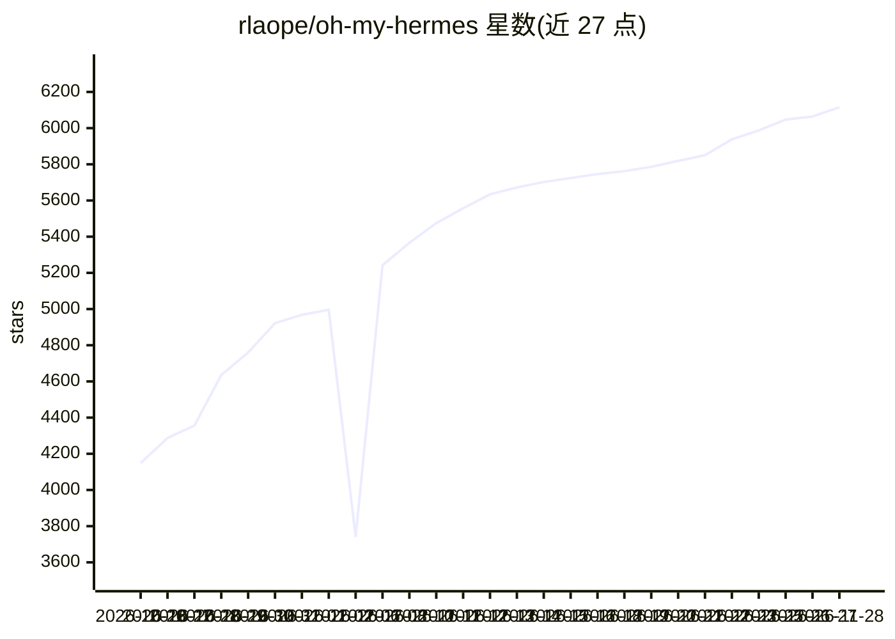

# rlaope/oh-my-hermes

⭐ 6,115 · Python · MIT · 推送 2026-11-27 · [GitHub](https://github.com/rlaope/oh-my-hermes) · [官网](https://omher.app/) · 个人维护 · 中文 README

**为 Hermes Agent 加装并行 AI 协作层的开发工作流工具**

oh-my-hermes 是构建在 Hermes Agent 之上的操作层（官方声明为独立非官方层）：用户输入 `/dag-ulw` 等触发词后，目标被拆为可并行执行的小节点图，每条 lane 按工作类别路由到不同模型与推理力度，provider 拒绝模型时链式降级到下一个。提供 100+ 个按需加载的 omh-* 专家技能、10 个 ulw- 工作流、LSP 工具、带写入理由的长期记忆，以及仅在实际测试/评审/CI 通过后判定 done 的证据机制。安装方式含脚本、Homebrew、Bun、npm 与桌面应用。

## 筛选速览

| 维度 | 判定 | 备注 |
|---|---|---|
| AI 角色 | `ai-ecosystem` | LLM/agent 周边工具 |
| 许可风险 | `permissive` | MIT |
| 部署形态 | `library` | 以包/库形式分发 |
| 模型依赖 | — | README 未给出锁定关系 |
| 硬件要求 | — | 无带数字的原话,不猜 |
| 安装摩擦 | `low` | 无编译、无系统依赖或容器化 |
| 成熟度 | — | 结构信号不足 |

## 能力要点

- `/dag-ulw` 将目标拆为并行节点图，节点按类别路由到不同模型链与推理力度
- 100+ 个 `omh-*` 专家技能由 router 按需加载为工具调用
- 验证机制：只有测试/评审/CI 实际通过才计为 verified
- 提供桌面应用统一管理 Hermes bots 与编码 agent 会话

## 适用场景

- 把大型开发任务拆成并行 lane 并按任务类型分配模型
- 在 Hermes 中按流程（访谈→计划→执行→验证）驱动编码工作
- 按模型族定制 prompt 校准并管理每类别的模型链

## 场景标签

`编码 Agent` `Agent 记忆` · 领域:Agent 开发

## 证据(README 行号)

> L16: **oh-my-hermes** is an operating layer for Hermes Agent.
> L87: > Hermes Agent by Nous Research The agent OMH runs on. OMH is an independent, unofficial layer on top.
> L296: |🧭 **Mixture-of-models routing**|Every delegated lane lands on a category (model + reasoning effort) at dispatch t

## 星数曲线

2026-10-26 4,149 → 2026-11-28 6,115（+1,966）

---
*卡片 v1 · prompt 1.4 · 生成 2026-11-27 · 置信度 high · 依据 README sha `09932301c7d0` · [字段定义](../../DATASET.md)*
