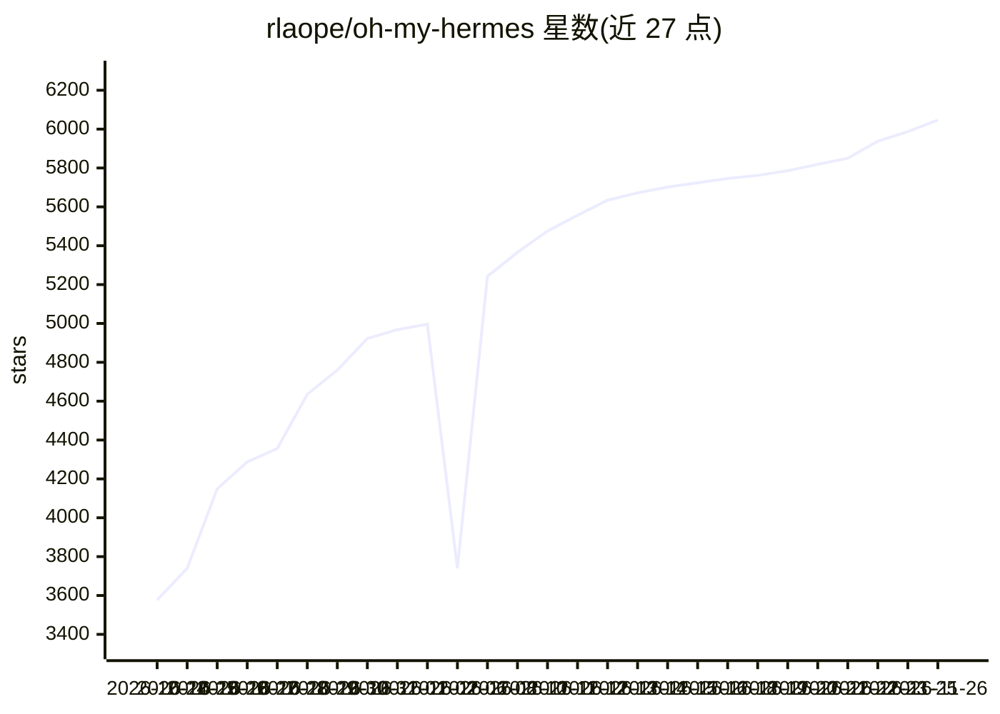

# rlaope/oh-my-hermes

⭐ 6,047 · Python · MIT · 推送 2026-11-25 · [GitHub](https://github.com/rlaope/oh-my-hermes) · [官网](https://omher.app/) · 个人维护 · 中文 README

**给 Hermes Agent 加多模型并行工作流的操作层**

在 Hermes Agent 之上运行的操作层：将任务拆成有向图节点并行执行，每条工作通道按类别（如 ultrabrain/deep/quick）路由到不同模型与推理强度，provider 拒绝时按链路切换到下一个模型。提供百余个 omh-* 专家技能由路由按需加载、LSP 集成（默认关闭）、带理由的长期记忆写入、以及以测试/评审/CI 通过为完成依据的验证机制。以 CLI 安装，另有 omher desktop 桌面应用聚合 Hermes 机器人与编码代理。

## 筛选速览

| 维度 | 判定 | 备注 |
|---|---|---|
| AI 角色 | `ai-ecosystem` | LLM/agent 周边工具 |
| 许可风险 | `permissive` | MIT |
| 部署形态 | `library` | 以包/库形式分发 |
| 模型依赖 | — | README 未给出锁定关系 |
| 硬件要求 | — | 无带数字的原话,不猜 |
| 安装摩擦 | `low` | 无编译、无系统依赖或容器化 |
| 成熟度 | — | 结构信号不足 |

## 能力要点

- 目标拆为并行节点图（/dag-ulw），各节点按类别路由到不同模型与推理强度
- 百余个 omh-* 专家技能由路由器按需加载为工具调用
- provider 拒绝模型时链路自动落到下一个模型
- 以测试/评审/CI 通过作为 done 的验证门槛，未执行的准备工作不报告为已执行

## 适用场景

- 让复杂开发任务在多条通道上按适配模型并行执行
- 在 Hermes 中按工作类别切换与校准各模型家族的提示
- 用验证门槛（测试/CI）约束 agent 报告的真实性

## 场景标签

`Agent 记忆` `编码 Agent` · 领域:Agent 开发

## 证据(README 行号)

> L16: **oh-my-hermes** is an operating layer for Hermes Agent.
> L31: - **The right model for every lane.**
> L270: Hermes Agent already runs the loop. OMH decides what goes into it: which

## 星数曲线

2026-10-24 3,577 → 2026-11-26 6,047（+2,470）

---
*卡片 v1 · prompt 1.4 · 生成 2026-11-26 · 置信度 high · 依据 README sha `8a85cd1546ce` · [字段定义](../../DATASET.md)*
