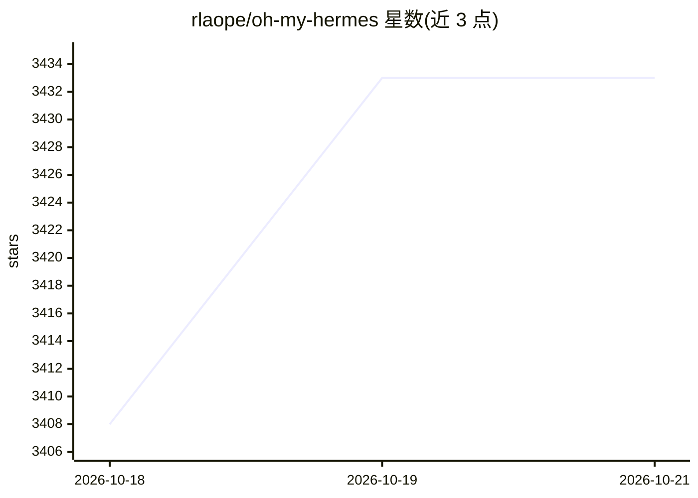

# rlaope/oh-my-hermes

⭐ 3,433 · Python · MIT · 推送 2026-10-19 · [GitHub](https://github.com/rlaope/oh-my-hermes) · [官网](https://rlaope.github.io/oh-my-hermes/) · 个人维护

**Hermes Agent 的一体化插件：编码智能、长期记忆与工作流层**

oh-my-hermes 是构建在 Hermes Agent 之上的单插件操作层：对请求做复杂度评分并路由到 12 类可编辑的模型链（每类为 model+effort 链，可按提供商拒答自动前进）；按 13 个模型家族做针对性提示校准；ulw-work 将计划拆分为互不共享文件的并行单元并回传带四种状态的类型化结果；内置 108 个 omh-* 专家技能随请求加载；提供基于评审卡的长期记忆系统（带来源与复审日期）。另含 OMH TUI 终端与 omh CLI，通过安装脚本、Homebrew、Bun、npm 或 Hermes skill tap 安装。

## 筛选速览

| 维度 | 判定 | 备注 |
|---|---|---|
| AI 角色 | `ai-ecosystem` | LLM/agent 周边工具 |
| 许可风险 | `permissive` | MIT |
| 部署形态 | `library` | 以包/库形式分发 |
| 模型依赖 | — | README 未给出锁定关系 |
| 硬件要求 | — | 无带数字的原话,不猜 |
| 安装摩擦 | `low` | 无编译、无系统依赖或容器化 |
| 成熟度 | — | 结构信号不足 |

## 能力要点

- 请求复杂度评分与 12 类可编辑模型链路由
- 13 个模型家族各有一段实测校准的提示块
- ulw-work 并行单元拆分，回传四状态类型化结果（含证据门）
- 108 个 omh-* 专家技能按需注入运行；评审制长期记忆系统

## 适用场景

- 让 Hermes Agent 的编码任务按成本与复杂度自动选模型
- 把计划拆成并行单元执行并核验证据后才算完成
- 为 agent 会话维护带来源与复审机制的长期记忆

## 场景标签

`Agent 记忆` `编码 Agent` `Agent 框架` · 领域:Agent 开发

## 证据(README 行号)

> L23:  oh-my-hermes (OMH) turns a normal
> L29:  OMH is the operating layer above Hermes-native skills: it frames the
> L179: OMH is three things for Hermes Agent, delivered as one plugin: the coding

## 星数曲线

2026-10-18 3,408 → 2026-10-21 3,433（+25）

---
*卡片 v1 · prompt 1.4 · 生成 2026-10-20 · 置信度 high · 依据 README sha `28a549905243` · [字段定义](../../DATASET.md)*
