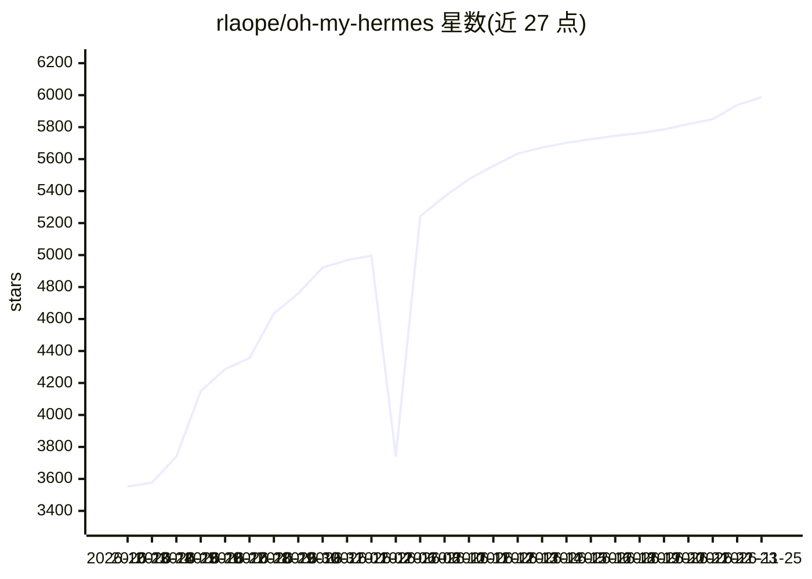

# rlaope/oh-my-hermes

⭐ 5,987 · Python · MIT · 推送 2026-11-24 · [GitHub](https://github.com/rlaope/oh-my-hermes) · [官网](https://omher.app/) · 个人维护 · 中文 README

**Hermes Agent 的操作层：多模型分道并行协作干活**

oh-my-hermes 是构建在 Hermes Agent 之上的独立操作层，不修补或替换 Hermes 本体。核心机制：将目标拆成可并行运行的小节点图（/dag-ulw），每条 lane 按工作类别（ultrabrain、deep、visual-engineering 等）选择模型链与推理强度，provider 拒绝模型时链条自动切换下一个；路由器按需加载一百多个 omh-* 专家技能；可选 LSP 工具、带写入理由的长期记忆、以测试/评审/CI 通过为验证标准的 done 判定。提供 CLI 与 omher 桌面应用（macOS/Linux/Windows）。

## 筛选速览

| 维度 | 判定 | 备注 |
|---|---|---|
| AI 角色 | `ai-ecosystem` | LLM/agent 周边工具 |
| 许可风险 | `permissive` | MIT |
| 部署形态 | `library` | 以包/库形式分发 |
| 模型依赖 | — | README 未给出锁定关系 |
| 硬件要求 | — | 无带数字的原话,不猜 |
| 安装摩擦 | `low` | 无编译、无系统依赖或容器化 |
| 成熟度 | — | 结构信号不足 |

## 能力要点

- 目标拆解为并行节点图，每节点按类别分配模型与推理强度
- 模型链条在 provider 拒绝时自动切换下一个，不静默降级
- 100+ omh-* 专家技能由路由器按需加载
- 独立节点验证目标，失败节点先修复再报告

## 适用场景

- 让多个模型分道并行完成大型编码任务
- 按工作类别自定义每个任务用什么模型和推理强度
- 在一个桌面窗口管理 Hermes bot 与多个 coding agent 会话

## 场景标签

`编码 Agent` `多智能体` `Agent 框架` `Agent 记忆` · 领域:Agent 开发

## 证据(README 行号)

> L16: **oh-my-hermes** is an operating layer for Hermes Agent.
> L17: You keep talking to Hermes. OMH puts a coworker with its own skill and model on each lane, in parallel.
> L270: Hermes Agent already runs the loop. OMH decides what goes into it: which

## 星数曲线

2026-10-23 3,552 → 2026-11-25 5,987（+2,435）

---
*卡片 v1 · prompt 1.4 · 生成 2026-11-22 · 置信度 high · 依据 README sha `0a4a0e5a68f8` · [字段定义](../../DATASET.md)*
