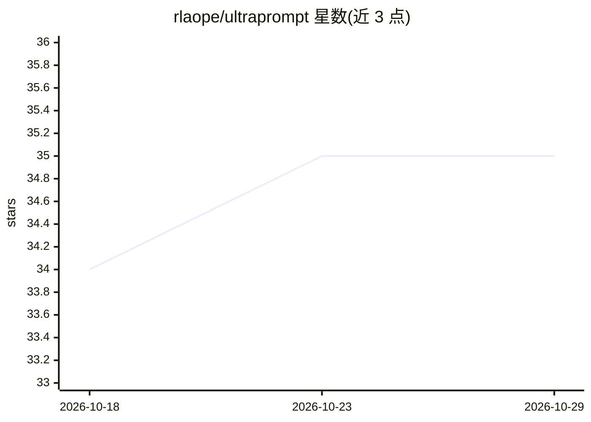

# rlaope/ultraprompt

⭐ 35 · Python · MIT · 推送 2026-10-28 · [GitHub](https://github.com/rlaope/ultraprompt) · 个人维护

**面向编码 agent 的可移植策略提示词技能库（12 个技能轴）**

一套以 SKILL.md 提示词形式发布的编码 agent 策略技能：计划从约 16 个案例域上运行前沿模型（Claude Fable 5.1 via Claude Code）的会话推理轨迹中提取重复策略，蒸馏为 8 个核心轴 + 4 个草稿轴的英文提示词技能。技能按策略而非领域组织，每个目录含 SKILL.md 与 CASES.md 证据日志。v0.2 为基线草稿，案例运行尚未执行，轨迹证据为占位符。安装通过 Claude Code 插件市场、一键安装脚本或将内容粘贴到任意 agent 的系统提示词。

## 筛选速览

| 维度 | 判定 | 备注 |
|---|---|---|
| AI 角色 | `ai-ecosystem` | LLM/agent 周边工具 |
| 许可风险 | `none` | MIT |
| 部署形态 | `None` |  |
| 模型依赖 | locked-api |  |
| 硬件要求 | — | 无带数字的原话,不猜 |
| 安装摩擦 | `low` | 无编译、无系统依赖或容器化 |
| 成熟度 | `idea` | |

## 能力要点

- 8 核心 + 4 草稿共 12 个策略轴提示词技能
- 计划从约 16 个案例域的模型会话轨迹中提取跨域重复策略
- 每个技能含 SKILL.md 与 CASES.md 轨迹证据日志
- 技能为自包含英文提示词，可粘贴进任意编码 agent 的系统提示词

## 适用场景

- 为我的编码 agent 加载探索、验证、假设管理等推理策略提示词
- 调试密集任务时叠加 hypothesis-management 与 self-correction-loop 技能
- 通过 Claude Code 插件市场一键安装全部技能

## 场景标签

`提示工程` · 领域:Agent 开发

## 证据(README 行号)

> L5: The pipeline: run a broad set of coding cases — frontend state machines, high-traffic backends, ML training loops, k
> L72: These are prompts, not code — there is nothing to build or execute. Install them one of three ways.
> L99: The skills are self-contained English with no Claude Code-specific syntax in their operative sections. For any othe

## 星数曲线

2026-10-18 34 → 2026-10-29 35（+1）

---
*卡片 v1 · prompt 1.4 · 生成 2026-10-25 · 置信度 high · 依据 README sha `4c77230e81c7` · [字段定义](../../DATASET.md)*
