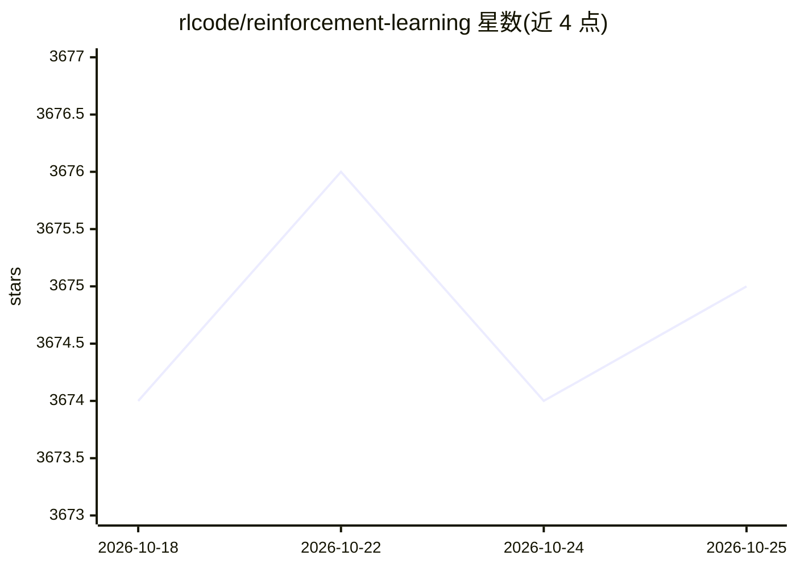

# rlcode/reinforcement-learning

⭐ 3,676 · Python · MIT · 推送 2026-06-12 · [GitHub](https://github.com/rlcode/reinforcement-learning) · 组织维护

**极简强化学习算法示例集：一算法一文件，从基础到深度 RL**

提供易读的强化学习代码示例，覆盖 9 个核心算法：Grid World 上的 Policy/Value Iteration、SARSA、Q-Learning、Deep SARSA、REINFORCE，CartPole 上的 DQN/A2C/PPO，以及 Atari 上的 DQN、PPO、PPO+RND 与 Go-Explore。2017 年版现代化重写：PyTorch 2.11 + gymnasium 1.2 + uv；每个算法文件开头附论文引用与核心更新公式。附 Apple Silicon 上的训练基准数据，Atari 脚本可选流式记录到 Weights & Biases。适合强化学习学习者阅读与复现。

## 筛选速览

| 维度 | 判定 | 备注 |
|---|---|---|
| AI 角色 | `ai-native` | 本体是模型或模型工具 |
| 许可风险 | `permissive` | MIT |
| 部署形态 | `None` |  |
| 模型依赖 | — | README 未给出锁定关系 |
| 硬件要求 | — | 无带数字的原话,不猜 |
| 安装摩擦 | `low` | 无编译、无系统依赖或容器化 |
| 成熟度 | — | 结构信号不足 |

## 能力要点

- 一算法一文件的 9 个核心 RL 算法实现（含 PPO、DQN、REINFORCE 等）
- 每个算法文件开头附论文引用与核心更新公式
- Apple M3/M4 Max 上的训练时间、得分、内存基准数据
- Atari 脚本可选 --wandb 流式记录训练指标

## 适用场景

- 学习强化学习算法并逐文件对照阅读实现
- 在本地复现 CartPole/Atari 训练结果
- 比较不同算法在 Atari 环境的基准表现

## 场景标签

`教程课程` · 领域:学习与行业

## 证据(README 行号)

> L1: From the basics to deep reinforcement learning, this repo provides easy-to-read code examples. One file for each alg
> L7: 1. Policy Iteration — `1-policy_iteration.py`

## 星数曲线

2026-10-18 3,674 → 2026-10-25 3,675（+1）

---
*卡片 v1 · prompt 1.4 · 生成 2026-10-20 · 置信度 high · 依据 README sha `a4dd0019a4eb` · [字段定义](../../DATASET.md)*
