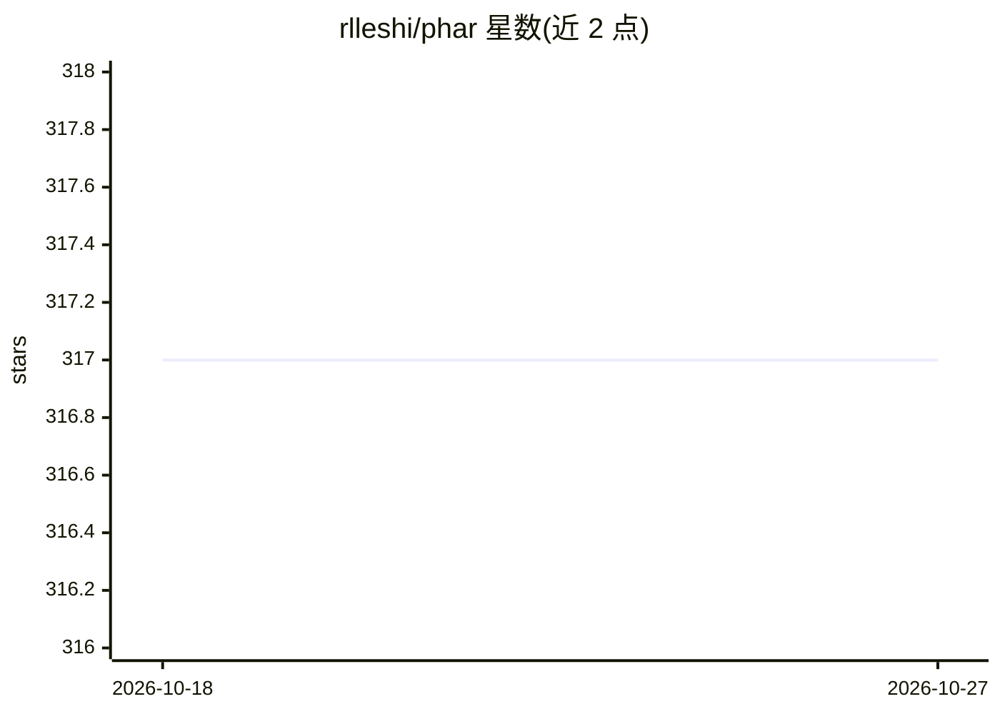

# rlleshi/phar

⭐ 317 · Python · Apache-2.0 · 推送 2026-06-12 · [GitHub](https://github.com/rlleshi/phar) · 个人维护

**面向成人视频的行为/体位深度学习分类器（多模态视频识别）**

个人副项目，将 SOTA 人体动作识别（HAR）方法应用于色情视频领域，对 7 秒视频片段进行 17 类动作/体位分类。机制上并行训练三个模型（RGB 流用 TimeSformer、骨架流用 PoseC3D、音频流用 ResNet101），结果经后期融合，权重为 0.5/0.6/1.0，Top1 准确率约 63.6%、Top2 约 75.2%。训练数据约 600 段视频、2674 分钟，规模较小。基于 MMAction2 生态构建，提供 Docker 镜像或手动安装（torch/mmcv/mmaction2/MMPose/MMDetection），含视频 demo、时间戳与标签生成脚本；内容过滤功能标注为 TODO。

## 筛选速览

| 维度 | 判定 | 备注 |
|---|---|---|
| AI 角色 | `ai-native` | 本体是模型或模型工具 |
| 许可风险 | `permissive` | Apache-2.0 |
| 部署形态 | `self-host` | docker 或自建部署 |
| 模型依赖 | — | README 未给出锁定关系 |
| 硬件要求 | — | 无带数字的原话,不猜 |
| 安装摩擦 | `low` | 无编译、无系统依赖或容器化 |
| 成熟度 | — | 结构信号不足 |

## 能力要点

- RGB+骨架+音频三流模型后期融合的动作识别
- 支持视频 demo、时间戳生成（--timestamps）与 Top-N 标签生成
- 提供 Docker 镜像构建方式，基于 MMAction2/MMPose/MMDetection
- 覆盖 17 类动作，训练集约 2674 分钟视频

## 适用场景

- 对成人视频自动生成动作标签与时间戳
- 视频内容分析与片段定位（每 7 秒输出预测）
- 作为成人领域动作识别研究的参考实现

## 场景标签

`多模态` · 领域:感知与多模态

## 证据(README 行号)

> L19: This is just a fun, side-project to see how State-of-the-art (SOTA) Human Action Recognition (HAR) models fare in t
> L23: This repository uses three different input streams in order to get the best possible results: rgb frames, human ske

## 星数曲线

2026-10-18 317 → 2026-10-27 317（+0）

---
*卡片 v1 · prompt 1.4 · 生成 2026-10-21 · 置信度 mid · 依据 README sha `0b02ba107813` · [字段定义](../../DATASET.md)*
