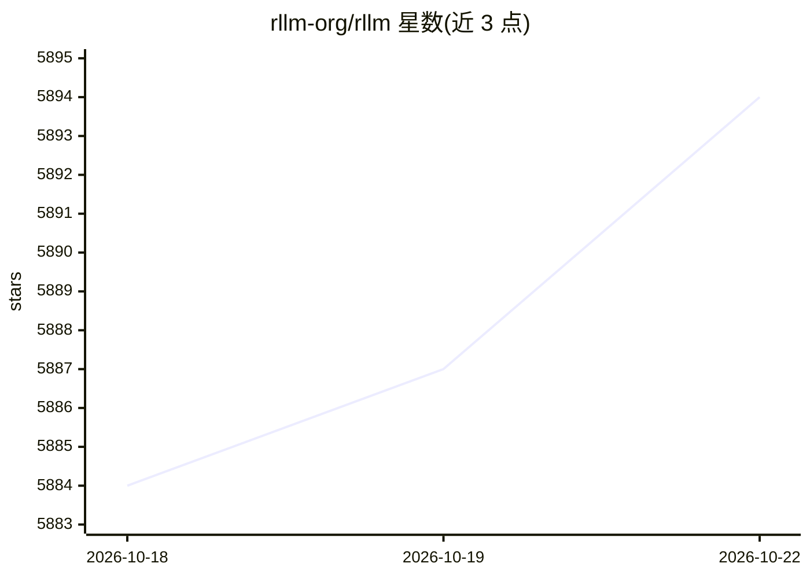

# rllm-org/rllm

⭐ 5,895 · Python · Apache-2.0 · 推送 2026-10-16 · [GitHub](https://github.com/rllm-org/rllm) · [官网](https://docs.rllm-project.com) · 组织维护

**面向开发者：用强化学习训练语言 agent 的开源框架**

rLLM 是用 RL 训练语言 agent 的开源框架：接入 10+ CLI harness（Claude Code、Codex 等）或用 @rllm.rollout 包装自有 agent；支持 Docker/Daytona/Modal/本地沙箱运行 rollouts；训练后端可在 verl（多 GPU 分布式）、tinker（单机）、fireworks 间用一个 flag 切换；内置 60+ 基准，`rllm eval` 自动拉取运行。训练方法含 GRPO、REINFORCE、RLOO、SFT、on-policy distillation。核心机制为模型网关透明捕获 token IDs 与 logprobs，同一 agent 代码同时驱动评测与训练。需 Python >= 3.11，pip 安装或源码构建，Docker 见安装指南。

## 筛选速览

| 维度 | 判定 | 备注 |
|---|---|---|
| AI 角色 | `ai-ecosystem` | LLM/agent 周边工具 |
| 许可风险 | `permissive` | Apache-2.0 |
| 部署形态 | `library` | 以包/库形式分发 |
| 模型依赖 | local-ok | 支持本地模型 |
| 硬件要求 | — | 无带数字的原话,不猜 |
| 安装摩擦 | `low` | 无编译、无系统依赖或容器化 |
| 成熟度 | — | 结构信号不足 |

## 能力要点

- 10+ CLI harness 接入与 @rllm.rollout 自定义 agent 包装
- 训练后端 verl/tinker/fireworks 一键切换，同一 API
- 60+ 集成基准，rllm eval 自动拉取运行
- 模型网关捕获 token IDs 与 logprobs，评测与训练共用同一 agent 代码

## 适用场景

- 用自己的编码/搜索 agent 做 RL 训练与对齐
- 在 SWE-bench、Terminal-Bench 等基准上评测并训练 agent
- 多 GPU 分布式或单机环境切换训练语言 agent

## 场景标签

`Agent 框架` `强化学习` `模型评测` · 领域:Agent 开发

## 证据(README 行号)

> L11: rLLM is an open-source framework for training language agents with reinforcement learning. Bring any harness, run i
> L17: - **Multiple training backends, one API.** `verl` (distributed multi-GPU), `tinker` (single-machine), `fireworks` (

## 星数曲线

2026-10-18 5,884 → 2026-10-22 5,894（+10）

---
*卡片 v1 · prompt 1.4 · 生成 2026-10-20 · 置信度 high · 依据 README sha `6d81698e3e02` · [字段定义](../../DATASET.md)*
