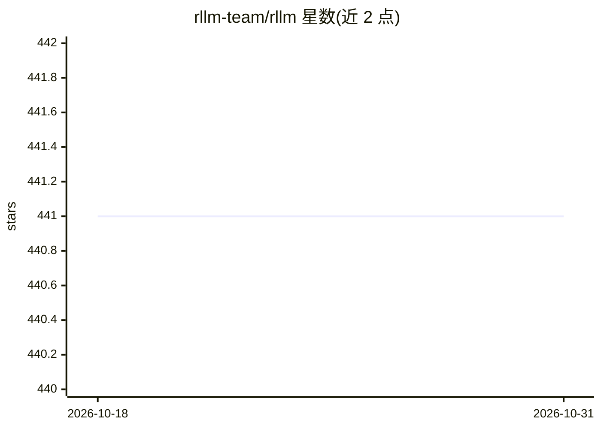

# rllm-team/rllm

⭐ 441 · Python · MIT · 推送 2026-10-15 · [GitHub](https://github.com/rllm-team/rllm) · [官网](https://relationllm.readthedocs.io/) · 组织维护 · 中文 README

**面向关系表学习（RTL）的 PyTorch 库，组合 GNN/LLM/TNN 模块**

rLLM 是上海交通大学与清华大学师生维护的 PyTorch 关系表学习库：将 GNN、LLM、TNN 拆解为标准化模块，支持以'组合、对齐、协同训练'方式构建新模型。内置 15+ 个 GNN/TNN 模型（如 OGC、ExcelFormer、TAPE、Trompt、InRTL），并引入三个关系表数据集与分类任务示例。接口兼容 LangChain 与 Hugging Face transformers，支持 SJTU 两门课程的本科与研究生教学使用。通过运行 examples 下脚本执行模型，GPU/TPU 优化仍在 Todo 列表。

## 筛选速览

| 维度 | 判定 | 备注 |
|---|---|---|
| AI 角色 | `ai-native` | 本体是模型或模型工具 |
| 许可风险 | `permissive` | MIT |
| 部署形态 | `None` |  |
| 模型依赖 | — | README 未给出锁定关系 |
| 硬件要求 | — | 无带数字的原话,不猜 |
| 安装摩擦 | `low` | 无编译、无系统依赖或容器化 |
| 成熟度 | — | 结构信号不足 |

## 能力要点

- GNN/LLM/TNN 标准化模块，支持组合-对齐-协同训练的建模方式
- 内置 15+ 个 GNN 与 TNN 模型（InRTL/OGC/ExcelFormer/TAPE/Trompt 等）
- 将社交/引文/电商网络统一为外键关联的多张表处理
- 提供三个新关系表数据集与标准分类任务示例

## 适用场景

- 在多张外键关联的数据表上做关系表学习建模
- 复用或组合 GNN/TNN 模型做表格数据分类任务
- 高校表格学习/图神经网络课程的教学与实验

## 场景标签

 · 领域:机器学习库/表格与图学习

## 证据(README 行号)

> L23: **rLLM** (relationLLM) is an easy-to-use Pytorch library for Relational Table Learning (RTL) with LLMs, by performi
> L24: 1. Breaks down state-of-the-art GNNs, LLMs, and TNNs as standardized modules.

## 星数曲线

2026-10-18 441 → 2026-10-31 441（+0）

---
*卡片 v1 · prompt 1.4 · 生成 2026-10-21 · 置信度 high · 依据 README sha `ec4673fbe883` · [字段定义](../../DATASET.md)*
