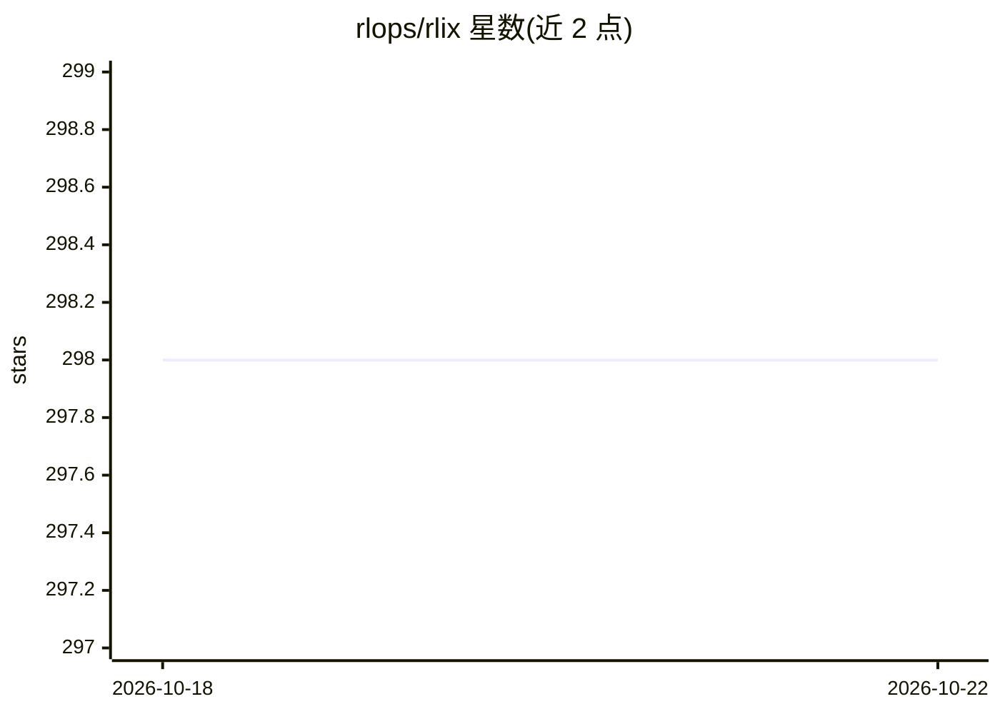

# rlops/rlix

⭐ 299 · Python · Apache-2.0 · 推送 2026-08-30 · [GitHub](https://github.com/rlops/rlix) · 组织维护

**让多个 RL 训练任务共享 GPU 的调度系统**

面向强化学习研究者的 GPU 共享与调度系统：让多个 RL 训练流水线共享 GPU 容量，减少任务排队等待并提高利用率，不改变各流水线自身的训练方式。支持 on-policy 与 off-policy 流水线，提供全参数微调（弹性扩缩 GPU）与 Multi-LoRA（共享基座模型并发训练多个适配器）两种内置流水线类型。调度上按阶段优先级分配 GPU，rollout 阶段优先级最低且可被抢占，可借用并归还空闲容量。基于 ROLL 构建，安装脚本面向已有 NVIDIA GPU 与驱动的 Linux 机器。

## 筛选速览

| 维度 | 判定 | 备注 |
|---|---|---|
| AI 角色 | `ai-ecosystem` | LLM/agent 周边工具 |
| 许可风险 | `permissive` | Apache-2.0 |
| 部署形态 | `None` |  |
| 模型依赖 | — | README 未给出锁定关系 |
| 硬件要求 | — | 无带数字的原话,不猜 |
| 安装摩擦 | `medium` | 含编译或系统依赖之一 |
| 成熟度 | — | 结构信号不足 |

## 能力要点

- 多 RL 任务共享 GPU 容量，rollout 阶段可抢占并弹性伸缩
- Multi-LoRA 流水线在共享基座模型上并发训练多个适配器
- 按 7 级阶段优先级调度 GPU，rollout 仅在活跃时加载推理权重
- 兼容 on-policy 与 off-policy 流水线并保持各自的 staleness 约束

## 适用场景

- GPU 紧张时并发跑更多 RL 实验与消融
- 长时程 agentic RL 中避免慢 rollout 阻塞其他任务
- 在同一基座模型上同时训练多个 LoRA 适配器

## 场景标签

`强化学习` `微调` `MLOps` · 领域:训练与推理

## 证据(README 行号)

> L23: RLix helps you get more out of the GPUs you already have. It lets multiple RL jobs share GPU capacity more effectiv
> L34: `setup_env.sh` is for Linux machines with working NVIDIA GPUs and drivers already installed. It installs Miniconda 

## 星数曲线

2026-10-18 298 → 2026-10-22 298（+0）

---
*卡片 v1 · prompt 1.4 · 生成 2026-10-21 · 置信度 high · 依据 README sha `6792762f736b` · [字段定义](../../DATASET.md)*
