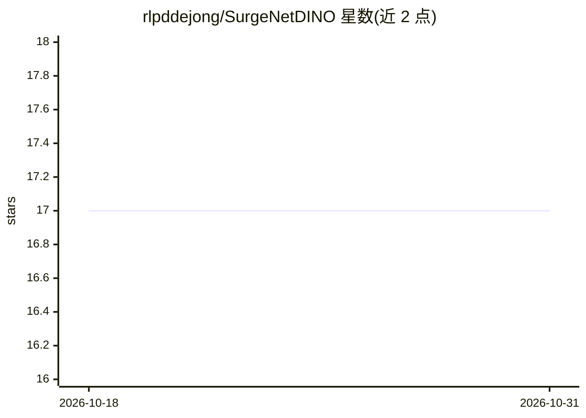

# rlpddejong/SurgeNetDINO

⭐ 17 · Python · MIT · 推送 2026-09-25 · [GitHub](https://github.com/rlpddejong/SurgeNetDINO) · [官网](https://openreview.net/forum?id=6FoIDPKzRV) · 个人维护

**手术场景表示学习论文代码：DINO 系列模型预训练权重与微调**

MIDL 2026 论文 "Towards Effective Surgical Representation Learning with DINO Models" 的官方仓库，提供 DINOv1/v2/v3 多种规模（ViT-S/B/L）的手术领域预训练权重下载、加载脚本与预训练配置。微调部分覆盖语义分割（基于 EoMT，需额外 pip 依赖）与手术阶段识别（引用 SurgPhaseBench），README 报告 CholecSeg8k、AutoLaparo 等数据集上的 Dice 与准确率结果。代码 MIT 许可，模型权重 CC-BY-NC-SA 禁止商用。需 Python 3.9+、torch、timm，示例用 Conda 建环境。

## 筛选速览

| 维度 | 判定 | 备注 |
|---|---|---|
| AI 角色 | `ai-native` | 本体是模型或模型工具 |
| 许可风险 | `permissive` | MIT |
| 部署形态 | `library` | 以包/库形式分发 |
| 模型依赖 | — | README 未给出锁定关系 |
| 硬件要求 | — | 无带数字的原话,不猜 |
| 安装摩擦 | `low` | 无编译、无系统依赖或容器化 |
| 成熟度 | — | 结构信号不足 |

## 能力要点

- 提供 DINOv1/v2/v3 共 8 种预训练权重变体（ViT-S/B/L）
- 支持语义分割与手术阶段识别两类微调任务
- 附预训练配置（DINOv1 为 .sh 脚本，v2/v3 为配置文件）
- 代码 MIT 许可，权重 CC-BY-NC-SA 非商业许可

## 适用场景

- 我在做手术视频语义分割，想用预训练 DINO 权重微调
- 我需要手术阶段识别的预训练表示模型
- 我想复现论文在 CholecSeg8k/AutoLaparo 上的结果

## 场景标签

`目标检测` `微调` · 领域:感知与多模态

## 证据(README 行号)

> L3: This repository contains the official code and pretrained model weights for the paper:
> L44: - **Semantic segmentation:** The code for finetuning the pretrained models on semantic segmentation can be found in
> L45: - **Surgical phase recognition:** For finetuning on surgical phase recognition, please refer to SurgPhaseBench.

## 星数曲线

2026-10-18 17 → 2026-10-31 17（+0）

---
*卡片 v1 · prompt 1.4 · 生成 2026-10-29 · 置信度 mid · 依据 README sha `309e44599868` · [字段定义](../../DATASET.md)*
