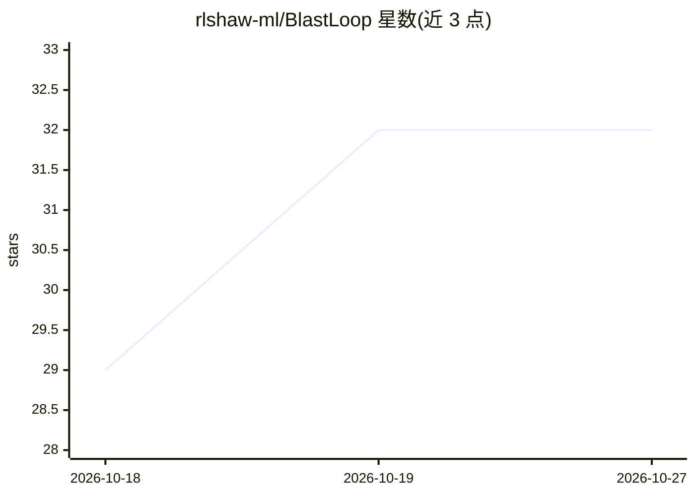

# rlshaw-ml/BlastLoop

⭐ 32 · MIT · 推送 2026-10-20 · [GitHub](https://github.com/rlshaw-ml/BlastLoop) · 个人维护

**给 AI 编码 agent 的结构优先编码与测试流程框架**

BlastLoop 是 Ross Shaw 提出的 AI 编码 agent 工作流程框架：将编码工作划分为 Blast（系统级）、Mid（子系统级）、Inner（局部单元）三个层级，各层有明确所有权；产出代码须依次通过 T1 结构检查、T2 缺陷/运维修复、T3 对抗性测试三道关卡，结构问题则回环重启。使用方式为克隆仓库、让 agent 加载 prompts/ 中的对应指令。以 MIT 许可的提示词与文档集合形式提供，非代码库或工具。

## 筛选速览

| 维度 | 判定 | 备注 |
|---|---|---|
| AI 角色 | `ai-ecosystem` | LLM/agent 周边工具 |
| 许可风险 | `permissive` | MIT |
| 部署形态 | `None` |  |
| 模型依赖 | — | README 未给出锁定关系 |
| 硬件要求 | — | 无带数字的原话,不猜 |
| 安装摩擦 | `low` | 无编译、无系统依赖或容器化 |
| 成熟度 | — | 结构信号不足 |

## 能力要点

- Blast/Mid/Inner 三个编码层级，各有明确所有权
- T1 结构 → T2 缺陷/运维 → T3 对抗测试的固定顺序测试环
- T3 发现结构问题按 T3→T1→修正→T2→T3 规则回环重启
- 可与其他 agent 风格（Spec Kit、vibe coding、红蓝测试）配合使用

## 适用场景

- 为 AI 编码 agent 建立分级编码与分阶段测试的作业流程
- 在 agent 产出代码后执行结构、运维、对抗三道质量关卡
- 需要明确变更所有权与交接规则的结构化团队协作

## 场景标签

`提示工程` · 领域:Agent 开发

## 证据(README 行号)

> L3: BlastLoop is Ross Shaw's practical coding framework for AI agents: **Blast**, **Mid**, and **Inner** write code at d
> L5: **Why it exists:** AI coding agents make teams faster, but they also make failure faster. BlastLoop applies an opera

## 星数曲线

2026-10-18 29 → 2026-10-27 32（+3）

---
*卡片 v1 · prompt 1.4 · 生成 2026-10-25 · 置信度 high · 依据 README sha `16ba98964102` · [字段定义](../../DATASET.md)*
