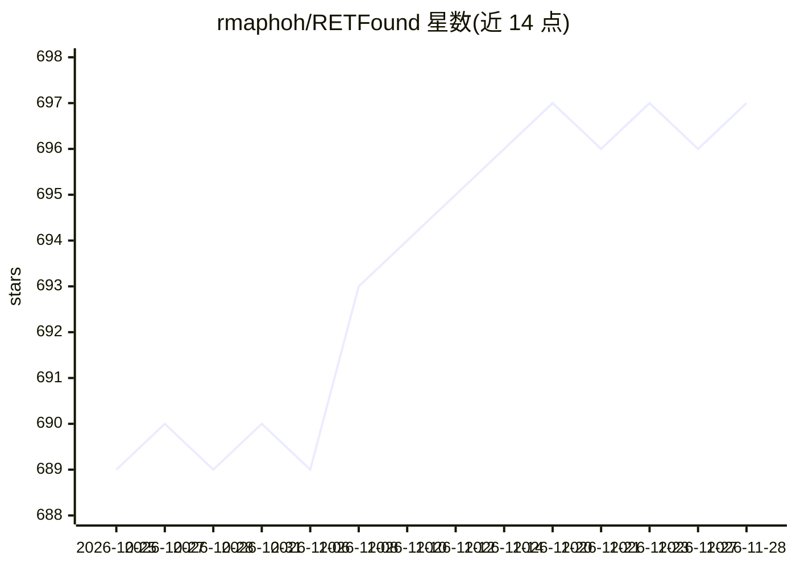

# rmaphoh/RETFound

⭐ 697 · Python · NOASSERTION · 推送 2026-11-17 · [GitHub](https://github.com/rmaphoh/RETFound) · 组织维护

**视网膜影像基础模型库，供医学影像研究微调疾病检测**

官方仓库，收录面向视网膜影像的一系列基础模型及其应用代码，含 RETFound-MAE、RETFound-DINOv2、DINOv2、DINOv3 多组预训练权重。RETFound 基于 160 万张视网膜影像自监督预训练，模型权重托管于 HuggingFace（需注册账号并填表获取访问权限）。提供 conda 环境搭建、数据目录组织、通过 train.sh 调整超参数进行微调的完整流程，支持微调与线性探测两种适配方式，并提供仅评测路径与 Colab notebook。

## 筛选速览

| 维度 | 判定 | 备注 |
|---|---|---|
| AI 角色 | `ai-native` | 本体是模型或模型工具 |
| 许可风险 | `none` | NOASSERTION |
| 部署形态 | `library` | 以包/库形式分发 |
| 模型依赖 | — | README 未给出锁定关系 |
| 硬件要求 | — | 无带数字的原话,不猜 |
| 安装摩擦 | `medium` | 含编译或系统依赖之一 |
| 成熟度 | — | 结构信号不足 |

## 能力要点

- 160 万张视网膜影像自监督预训练的 RETFound 权重
- 支持 MAE/DINOv2/DINOv3 多组预训练权重的微调
- 权重托管 HuggingFace，提供 hf-mirror 备用端点
- 提供仅评测路径与 Colab notebook

## 适用场景

- 在自己的视网膜影像数据集上微调基础模型做疾病检测
- 对比不同预训练数据与预训练方法在眼底任务上的表现
- 对公开数据集只做模型评测

## 场景标签

`微调` `模型评测` · 领域:评测与运维

## 证据(README 行号)

> L4: `[RETFound-MAE]`:RETFound: a foundation model for generalizable disease detection from retinal images.
> L13: - RETFound is pre-trained on 1.6 million retinal images with self-supervised learning
> L100: 5. Start fine-tuning by running `sh train.sh`.

## 星数曲线

2026-10-25 689 → 2026-11-28 697（+8）

---
*卡片 v1 · prompt 1.4 · 生成 2026-11-24 · 置信度 high · 依据 README sha `1f07874dd62e` · [字段定义](../../DATASET.md)*
