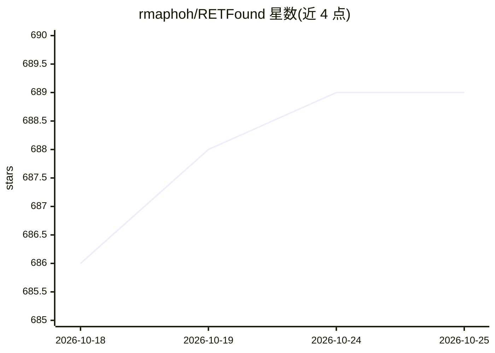

# rmaphoh/RETFound

⭐ 689 · Python · NOASSERTION · 推送 2025-11-30 · [GitHub](https://github.com/rmaphoh/RETFound) · 组织维护 · 中文 README

**视网膜图像基础模型：用于眼科疾病检测与微调**

提供 RETFound（基于 MAE 与 DINOv2 架构，约 300M 参数）等视网膜图像基础模型及微调流水线。模型在 160 万张视网膜图像上以自监督方式预训练，已在多个疾病检测任务上验证，支持通过修改 train.sh 超参数切换 RETFound/DINOv2/DINOv3 多种骨干进行微调或线性探测，另提供仅评估路径。权重托管于 HuggingFace（需申请访问），环境基于 conda + pip 安装，要求 CUDA 12+ 与 PyTorch 2.3+。面向医学影像研究人员，附带 Colab notebook。

## 筛选速览

| 维度 | 判定 | 备注 |
|---|---|---|
| AI 角色 | `ai-native` | 本体是模型或模型工具 |
| 许可风险 | `none` | NOASSERTION |
| 部署形态 | `library` | 以包/库形式分发 |
| 模型依赖 | — | README 未给出锁定关系 |
| 硬件要求 | — | 无带数字的原话,不猜 |
| 安装摩擦 | `medium` | 含编译或系统依赖之一 |
| 成熟度 | — | 结构信号不足 |

## 能力要点

- RETFound 在 160 万张视网膜图像上自监督预训练
- 支持 RETFound(MAE)/DINOv2/DINOv3 多种骨干微调与线性探测
- 预训练权重托管 HuggingFace（含 MAE 与 DINOv2 版本）
- 提供公开数据集的数据划分、模型检查点与 Colab notebook

## 适用场景

- 在我的视网膜数据集上微调 RETFound 做疾病检测
- 对比通用（DINOv2/v3）与专用（RETFound）视觉基础模型的眼科表现
- 使用公开检查点对眼底/OCT 数据做仅评估推理

## 场景标签

`微调` `目标检测` · 领域:感知与多模态

## 证据(README 行号)

> L4: `[RETFound-MAE]`:RETFound: a foundation model for generalizable disease detection from retinal images.
> L13: - RETFound is pre-trained on 1.6 million retinal images with self-supervised learning
> L14: - RETFound has been validated in multiple disease detection tasks

## 星数曲线

2026-10-18 686 → 2026-10-25 689（+3）

---
*卡片 v1 · prompt 1.4 · 生成 2026-10-21 · 置信度 mid · 依据 README sha `a04e777ea61b` · [字段定义](../../DATASET.md)*
