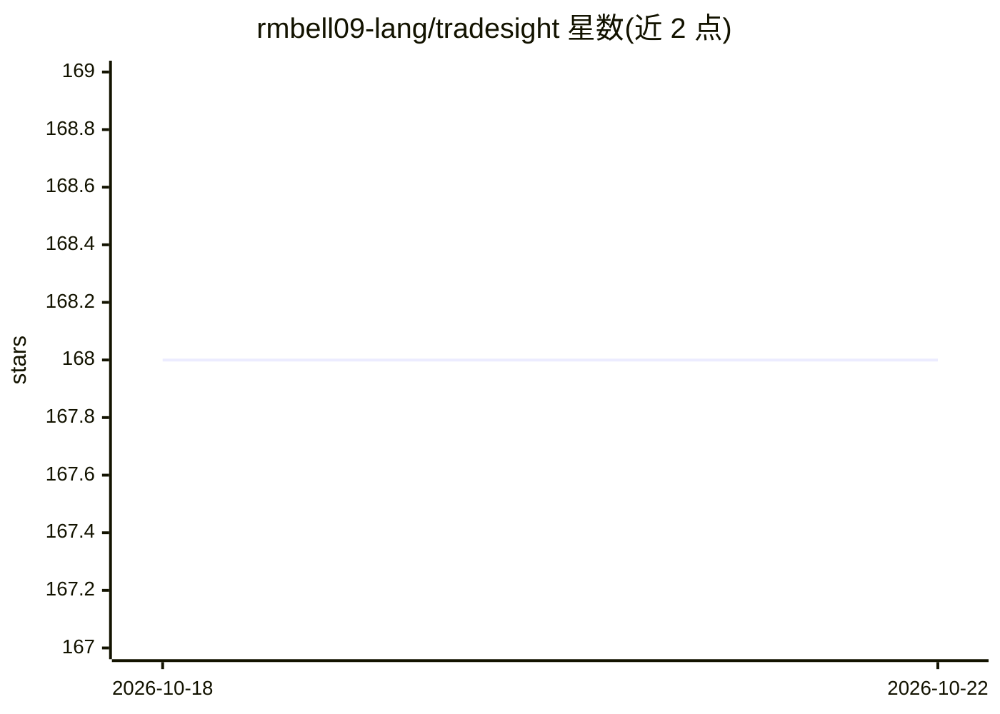

# rmbell09-lang/tradesight

⭐ 169 · Python · 推送 2026-10-08 · [GitHub](https://github.com/rmbell09-lang/tradesight) · [官网](https://rmbell09-lang.github.io/tradesight/) · 组织维护

**自托管的策略研究与 Alpaca 模拟盘交易系统（仅 paper 模式）**

TradeSight 是面向量化交易研究者（QC Autonomous 维护）的自托管策略研究应用：对历史数据评估策略家族，保留 champion/challenger 证据链，接入 Alpaca paper 账户进行券商模拟下单与对账。关键机制包括分层数据标签（REAL/PAPER/DEMO/STALE/UNVERIFIED）、多阶段证据门槛（样本外、walk-forward、蒙特卡洛、前瞻模拟）与策略生命周期管理。限制：技术上锁定为 paper trading，无实盘执行路径；需 Python 3.11+、macOS/Linux。MIT 许可，另有 $49 付费打包发行版（可选）。

## 筛选速览

| 维度 | 判定 | 备注 |
|---|---|---|
| AI 角色 | `ai-ecosystem` | LLM/agent 周边工具 |
| 许可风险 | `none` | — |
| 部署形态 | `library` | 以包/库形式分发 |
| 模型依赖 | — | README 未给出锁定关系 |
| 硬件要求 | — | 无带数字的原话,不猜 |
| 安装摩擦 | `low` | 无编译、无系统依赖或容器化 |
| 成熟度 | — | 结构信号不足 |

## 能力要点

- Alpaca paper 端点模拟下单与本地/券商账务对账
- 五级数据标签体系与证据门槛（样本外/walk-forward/蒙特卡洛等）
- 策略生命周期：Candidate→Backtest→Champion→Retired，challenger 不可自动晋级
- 技术锁定 paper trading，无实盘激活端点

## 适用场景

- 量化策略回测与研究，保留完整晋级证据
- 接入 Alpaca 模拟盘验证策略执行与对账
- 需要严格区分真实/模拟/未验证数据的研究流程

## 场景标签

`金融量化` · 领域:学习与行业

## 证据(README 行号)

> L3: TradeSight is a self-hosted strategy-research and **paper-trading** application. It evaluates strategy families agai
> L5: TradeSight is research software. It is not financial advice, does not promise returns, and does not contain an enabl

## 星数曲线

2026-10-18 168 → 2026-10-22 168（+0）

---
*卡片 v1 · prompt 1.4 · 生成 2026-10-22 · 置信度 low · 依据 README sha `a9bbe1052695` · [字段定义](../../DATASET.md)*
