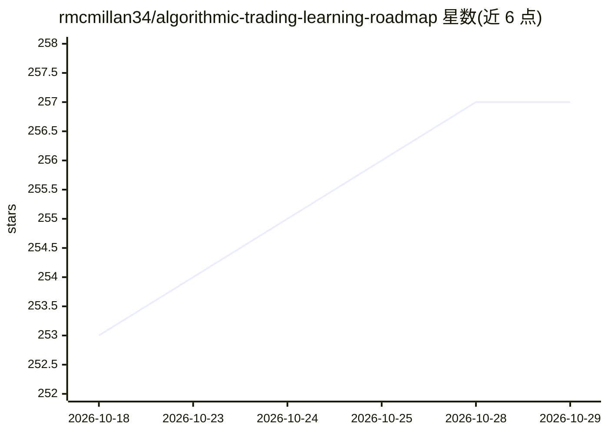

# rmcmillan34/algorithmic-trading-learning-roadmap

⭐ 257 · Shell · MIT · 推送 2026-02-07 · [GitHub](https://github.com/rmcmillan34/algorithmic-trading-learning-roadmap) · 个人维护

**面向独立算法交易者的自学路线图与资源模板库**

个人维护的自学路线图仓库：以层级化文件夹结构组织算法交易所需的多学科资源，覆盖 AI/机器学习、数据科学、金融、数学、软件工程、云与 DevOps、计算机科学等 9 个领域。每个领域与主题下含 README.md，列出书籍、在线课程、认证与项目想法，并提供 Assets 区存放 Anki 闪卡、Obsidian 笔记库等个人资料。设计为本地克隆后自用的可定制模板，用户按主题渐进学习并记录进度。不含可运行代码，MIT 许可。

## 筛选速览

| 维度 | 判定 | 备注 |
|---|---|---|
| AI 角色 | `ai-knowledge` | 知识聚合/清单类 |
| 许可风险 | `permissive` | MIT |
| 部署形态 | `None` |  |
| 模型依赖 | — | README 未给出锁定关系 |
| 硬件要求 | — | 无带数字的原话,不猜 |
| 安装摩擦 | `medium` | 含编译或系统依赖之一 |
| 成熟度 | — | 结构信号不足 |

## 能力要点

- 层级化模块结构：领域→主题→资源的 Markdown 文件组织
- 覆盖 9 个领域约 100+ 主题的策展资源清单
- 提供 Anki 闪卡、Obsidian 笔记库等个人资源存储结构
- 各主题含推荐书籍、课程、认证与项目想法

## 适用场景

- 我想系统自学成为独立算法交易者，需要结构化学习清单
- 整理自己积累的课程、书籍与项目资料并跟踪进度
- 查找特定领域（如强化学习、量化金融）的推荐资源

## 场景标签

`精选清单` `教程课程` `金融量化` · 领域:学习与行业

## 证据(README 行号)

> L11: Welcome to the Algorithmic Trading Learning Roadmap repository! This repository provides a structured, comprehensiv
> L14: This repository is organized in a hierarchical folder structure, each top-level folder focusing on a key area of kn
> L60: - **Markdown files**: Each domain and subject contains a README.md file outlining the topic and a list of resources

## 星数曲线

2026-10-18 253 → 2026-10-29 257（+4）

---
*卡片 v1 · prompt 1.4 · 生成 2026-10-22 · 置信度 high · 依据 README sha `0ac0a4ca7b41` · [字段定义](../../DATASET.md)*
