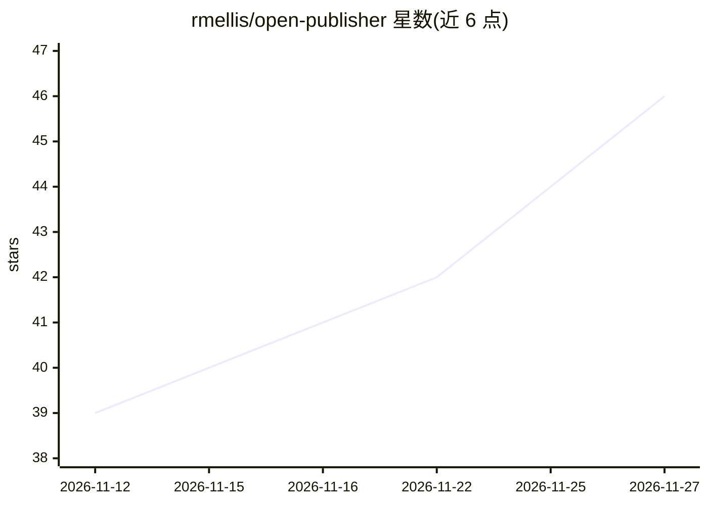

# rmellis/open-publisher

⭐ 46 · JavaScript · GPL-2.0 · 推送 2026-11-26 · [GitHub](https://github.com/rmellis/open-publisher) · [官网](https://openpublisher.app) · 个人维护

**免费跨平台桌面排版软件：替代 Microsoft Publisher 设计印刷品**

面向个人与小型出版需求的 WYSIWYG 桌面排版应用，定位为 Microsoft Publisher 的免费替代，用于设计新闻稿、传单、名片、海报、手册等。提供精确排版、富文本排版、图像处理与导出能力，支持导入 .pub、PDF 与 Word 文件。V5 重构了桌面外壳、画布引擎与打印管线，包含崩溃安全保存、自动备份、系统托盘集成、导出/打印队列监视器与演示预览窗口等。以桌面安装包（Windows/macOS/Linux/FreeBSD）与浏览器版提供，另有付费知识库文档与 Patreon 赞助渠道。

## 筛选速览

| 维度 | 判定 | 备注 |
|---|---|---|
| AI 角色 | `ai-enhanced` | 去掉 AI 部分产品仍成立 |
| 许可风险 | `viral` | GPL-2.0 |
| 部署形态 | `desktop` | 安装包/桌面程序 |
| 模型依赖 | — | README 未给出锁定关系 |
| 硬件要求 | — | 无带数字的原话,不猜 |
| 安装摩擦 | `low` | 无编译、无系统依赖或容器化 |
| 成熟度 | — | 结构信号不足 |

## 能力要点

- 覆盖 Windows/macOS/Linux/FreeBSD 的多格式安装包与免安装浏览器版
- 4 步崩溃安全原子保存管线与自动备份/历史版本（最多 50 快照/文档）
- 导出与打印队列实时监视窗口、任务栏进度显示
- 支持 .pub、PDF、Word 文件导入

## 适用场景

- 免费制作传单、名片、小册子等印刷品，不想订阅付费排版软件
- 在浏览器中或桌面端排版并导出 300 DPI 印刷文件
- 从 Microsoft Publisher 文件迁移到免费工具

## 场景标签

 · 领域:桌面出版/图形设计

## 证据(README 行号)

> L14: Open Publisher is a WYSIWYG (What You See Is What You Get) desktop publishing application built as a free alternati
> L63: > 🎬 **Watch Video Tutorial: Creating Layered Templates with AI & Layout Tools** · **Open the Back To School Templat

## 星数曲线

2026-11-12 39 → 2026-11-27 46（+7）

---
*卡片 v1 · prompt 1.4 · 生成 2026-11-18 · 置信度 mid · 依据 README sha `7fdf15d950ac` · [字段定义](../../DATASET.md)*
