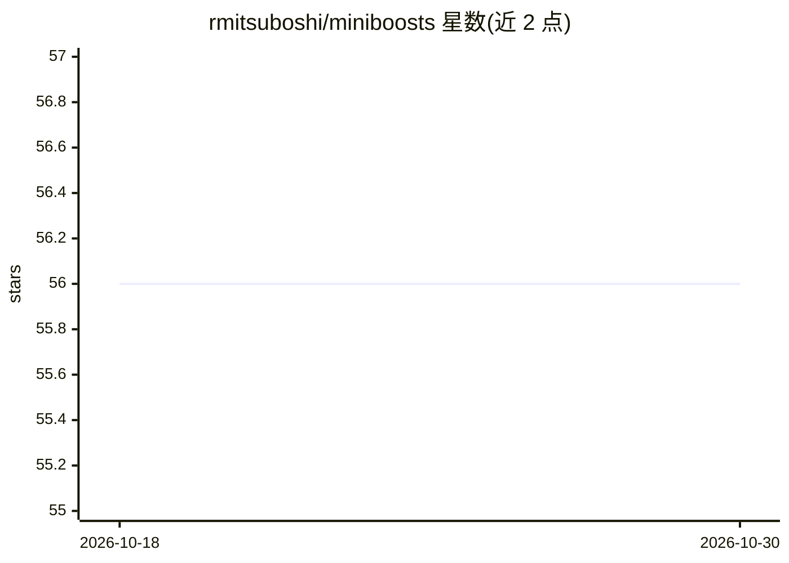

# rmitsuboshi/miniboosts

⭐ 56 · Rust · MIT · 推送 2026-10-29 · [GitHub](https://github.com/rmitsuboshi/miniboosts) · 个人维护

**Rust 实现的 boosting 算法库，用于实现与对比**

以 Rust 编写的 boosting 算法库，收录 AdaBoost、AdaBoostV、LpBoost、ErlpBoost、SoftBoost、GraphSeparationBoosting 等 11 种算法，统一实现 Booster、WeakLearner、Classifier trait，使同一数据与弱学习器可跨实验复用。内置决策树弱学习器，可自行实现 WeakLearner 扩展；优化依赖 Clarabel 求解线性/二次/锥规划，无需 Gurobi。提供命令行实验 runner 生成学习曲线 CSV 与绘图脚本。此工作区版本未发布到 crates.io，需以本地 checkout 方式依赖，要求 Rust 1.85+（edition 2024）。

## 筛选速览

| 维度 | 判定 | 备注 |
|---|---|---|
| AI 角色 | `ai-native` | 本体是模型或模型工具 |
| 许可风险 | `permissive` | MIT |
| 部署形态 | `library` | 以包/库形式分发 |
| 模型依赖 | — | README 未给出锁定关系 |
| 硬件要求 | — | 无带数字的原话,不猜 |
| 安装摩擦 | `low` | 无编译、无系统依赖或容器化 |
| 成熟度 | `idea` | |

## 能力要点

- 11 种 boosting 算法共享统一 trait，便于同数据对比
- 优化使用 Clarabel，无需 Gurobi 安装与许可
- 实验 runner 可运行单一或全部算法并保存学习曲线 CSV
- GBM 与回归树未包含在当前工作区中

## 适用场景

- 在同一数据与弱学习器上对比多种 boosting 算法
- 复现 boosting 相关论文中的算法行为
- 以自定义弱学习器扩展进行 boosting 实验

## 场景标签

 · 领域:机器学习/算法库

## 证据(README 行号)

> L3: MiniBoosts is a Rust library for implementing and comparing boosting algorithms.
> L43: |`AdaBoost`|[Freund and Schapire][adaboost]|

## 星数曲线

2026-10-18 56 → 2026-10-30 56（+0）

---
*卡片 v1 · prompt 1.4 · 生成 2026-10-24 · 置信度 high · 依据 README sha `6a12e18ea406` · [字段定义](../../DATASET.md)*
