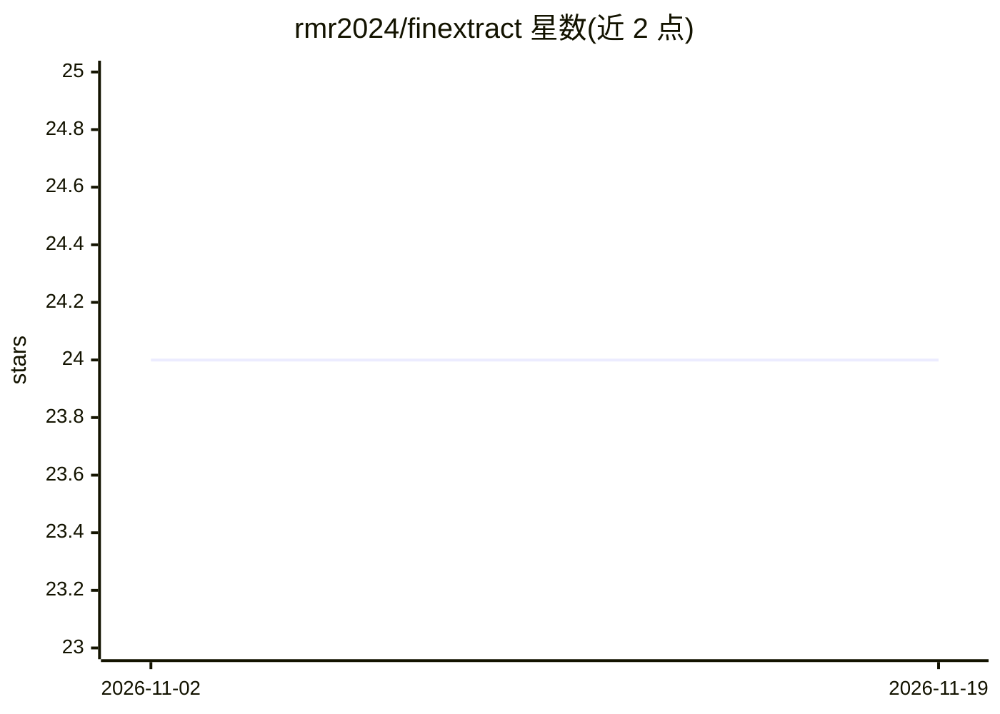

# rmr2024/finextract

⭐ 24 · Python · MIT · 推送 2026-11-01 · [GitHub](https://github.com/rmr2024/finextract) · 个人维护

**基准+流水线：LLM 从 SEC 10-K 提取财务数字并测错因**

针对 LLM 从 SEC 10-K 文件提取财务数字的基准与流水线：BM25 检索定位表格行，LLM 返回 value/scale/quote，确定性离线的 snap-to-source 校验把引用对齐真实申报行并重读数字，将 held-out 精确匹配从 75.0% 提升到 84.1%。答案按错误类别（scale/sign/period 等）分类，标签来自 XBRL。提供 CLI、FastAPI 服务与查错 dashboard，pip 安装并附 Docker。作者自述这是方法基准而非产品，样本仅 5+5 份申报。

## 筛选速览

| 维度 | 判定 | 备注 |
|---|---|---|
| AI 角色 | `ai-ecosystem` | LLM/agent 周边工具 |
| 许可风险 | `permissive` | MIT |
| 部署形态 | `self-host` | docker 或自建部署 |
| 模型依赖 | — | README 未给出锁定关系 |
| 硬件要求 | — | 无带数字的原话,不猜 |
| 安装摩擦 | `low` | 无编译、无系统依赖或容器化 |
| 成熟度 | — | 结构信号不足 |

## 能力要点

- 确定性离线校验重读真实申报行，无需额外 LLM 调用
- 每条答案标注错误类别（correct/near_miss/scale_error 等）
- CLI 内置离线 demo 与可续跑（--resume）跑批
- FastAPI 服务 + dashboard 展示值、标签、正误与来源行

## 适用场景

- 评估 LLM 财务数字提取的幻觉率与失败模式
- 对无 XBRL 标签的申报类文档提取并核验数字
- 用 dashboard 逐字段检查提取结果与原文出处

## 场景标签

`模型评测` `文档解析` · 领域:评测与运维

## 证据(README 行号)

> L3: A benchmark and pipeline for extracting financial figures from SEC 10-K filings with LLMs, and for
> L10: the number from the real filing line. That fixes these copying errors, taking held-out exact accuracy
> L62: 4. **Score.** Every answer gets an error class: `correct`, `near_miss`, `scale_error`, `sign_error`,

## 星数曲线

2026-11-02 24 → 2026-11-19 24（+0）

---
*卡片 v1 · prompt 1.4 · 生成 2026-11-18 · 置信度 high · 依据 README sha `9056b7a629f5` · [字段定义](../../DATASET.md)*
