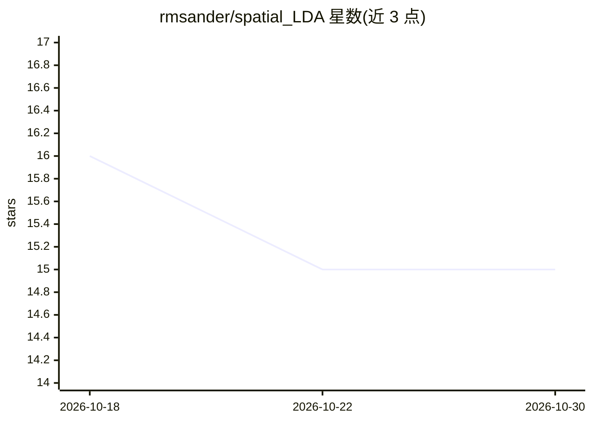

# rmsander/spatial_LDA

⭐ 15 · Python · 推送 2026-10-20 · [GitHub](https://github.com/rmsander/spatial_LDA) · 组织维护

**无监督图像聚类研究代码：LDA+SIFT+CNN 特征自动归类图片**

面向计算机视觉研究者与研究生的无监督图像组织框架：用 SIFT 关键点、ImageNet 预训练 CNN 中间层激活经 K-Means 离散化为视觉词袋特征，再以 Latent Dirichlet Allocation 将无标注图像聚入潜在类别，用于加速标注与数据整理流程。代码位于 python/ 目录，通过 lda.py 运行完整管线或对已聚类特征做 LDA；另含 PCA 与 VAE 基线。在 ADE20K（150 类标签）上验证，最优超参数为 300 簇/300 关键点/20 主题。附最终论文与海报 PDF，课程项目（MIT 6.867）产出。

## 筛选速览

| 维度 | 判定 | 备注 |
|---|---|---|
| AI 角色 | `ai-native` | 本体是模型或模型工具 |
| 许可风险 | `none` | — |
| 部署形态 | `library` | 以包/库形式分发 |
| 模型依赖 | — | README 未给出锁定关系 |
| 硬件要求 | — | 无带数字的原话,不猜 |
| 安装摩擦 | `low` | 无编译、无系统依赖或容器化 |
| 成熟度 | — | 结构信号不足 |

## 能力要点

- SIFT+预训练 CNN 特征经 K-Means 离散化后由 LDA 聚类无标注图像
- 支持仅对已聚类特征运行 LDA 的灵活管线
- 内置 PCA 与 VAE 基线（pca.py / vae.py）
- 用 L2 范数与对称 KL 散度评估聚类质量

## 适用场景

- 我在做有监督视觉任务但缺标注数据，想先无监督把图像分组
- 研究/复现视觉词袋 + 主题模型的无监督聚类方法
- 用 PCA/VAE 基线对比聚类框架效果

## 场景标签

`图像视频处理` · 领域:感知与多模态

## 证据(README 行号)

> L4: This repository contains the implementation of an unsupervised image organization model for use in semi-automation o
> L5: annotation and data curation process. It uses Latent Dirichlet Allocation (LDA), Scale-Invariant Feature Transform (
> L6: pre-trained Convolutional Neural Network (CNN) filters to cluster unlabeled images into different categories using l

## 星数曲线

2026-10-18 16 → 2026-10-30 15（-1）

---
*卡片 v1 · prompt 1.4 · 生成 2026-10-30 · 置信度 mid · 依据 README sha `bd18fc195a8b` · [字段定义](../../DATASET.md)*
