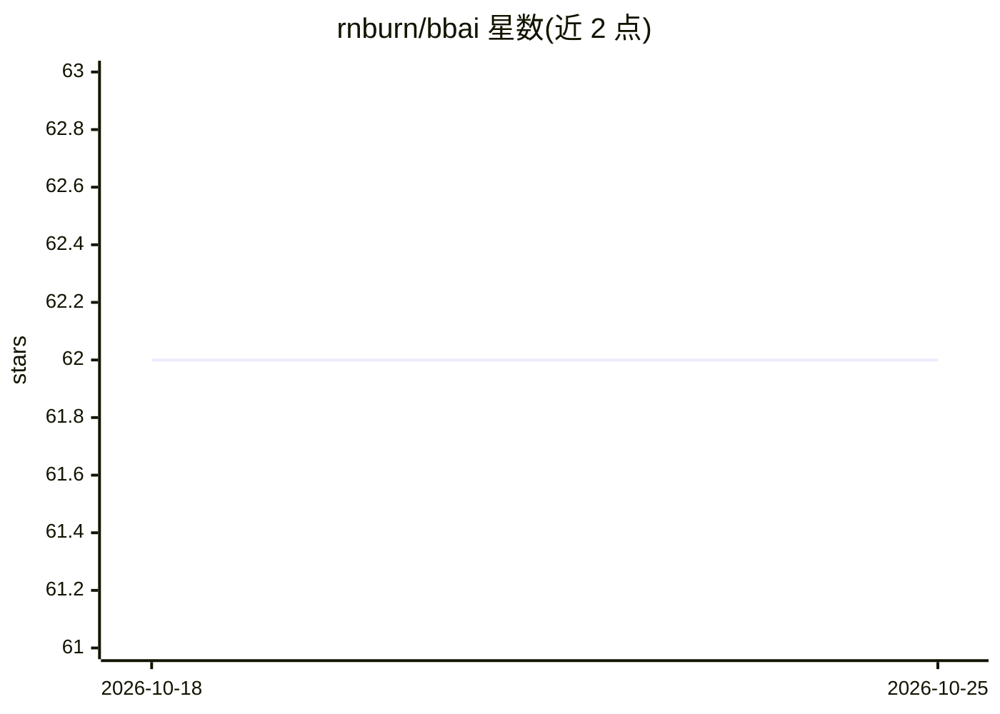

# rnburn/bbai

⭐ 62 · Python · CC-BY-4.0 · 推送 2026-02-01 · [GitHub](https://github.com/rnburn/bbai) · [官网](https://buildingblock.ai/) · 个人维护

**客观贝叶斯推断与超参数优化的确定性算法库**

Python 库 bbai，提供客观贝叶斯推断（基于 Jeffreys/参考先验）与超参数优化的确定性、精确算法。功能包括：贝叶斯高斯过程回归（对参数空间全积分）、以优化 LOOCV 方式精确设定正则化参数的 Lasso/岭/逻辑回归、贝叶斯岭回归、EEIBF 假设检验、二项比例比较、Chebyshev 节点自适应稀疏网格插值，以及三次 Bezier 曲线拟合。仅支持 Linux x86-64 平台。

## 筛选速览

| 维度 | 判定 | 备注 |
|---|---|---|
| AI 角色 | `ai-native` | 本体是模型或模型工具 |
| 许可风险 | `viral` | CC-BY-4.0 |
| 部署形态 | `library` | 以包/库形式分发 |
| 模型依赖 | — | README 未给出锁定关系 |
| 硬件要求 | — | 无带数字的原话,不猜 |
| 安装摩擦 | `low` | 无编译、无系统依赖或容器化 |
| 成熟度 | — | 结构信号不足 |

## 能力要点

- 参考先验下的贝叶斯高斯过程回归（参数空间全积分）
- 以优化 LOOCV 精确设定正则化参数的 Lasso/岭/逻辑回归
- EEIBF 假设检验与二项比例比较的客观贝叶斯推断
- Chebyshev 节点自适应稀疏网格插值与 Bezier 曲线拟合

## 适用场景

- 为回归模型做带无信息先验的贝叶斯推断
- 通过 LOOCV 精确选择正则化超参数
- 做正态均值或二项比例的贝叶斯假设检验

## 场景标签

 · 领域:统计/机器学习库

## 证据(README 行号)

> L4: Deterministic, exact algorithms for objective Bayesian inference and hyperparameter optimization.
> L96: ### Objective Bayesian Inference for Gaussian Process Models

## 星数曲线

2026-10-18 62 → 2026-10-25 62（+0）

---
*卡片 v1 · prompt 1.4 · 生成 2026-10-24 · 置信度 high · 依据 README sha `6940d38f8363` · [字段定义](../../DATASET.md)*
