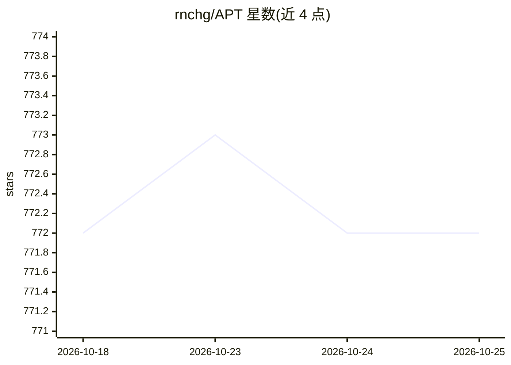

# rnchg/APT

⭐ 772 · C# · MIT · 推送 2025-12-13 · [GitHub](https://github.com/rnchg/APT) · 个人维护 · 中文 README

**面向普通用户的本地离线 AI 图片/视频/音频批量处理桌面工具**

免费开源的 Windows 桌面端 AI 效率工具，本地部署、离线运行，数据不上传。功能分四块：内置本地模型对话（README 称 ChatGPT、DeepSeek、Phi、Qwen 等）；图片处理含超分、去水印、卡通化、转 3D、上色、插帧、抠图、人脸修复；视频处理含超分、去水印、转 3D、插帧、抠像等；音频处理含人声分离、降噪，语音合成与语音转文字标注为测试中。解压即用无需安装配置。平台方面 Windows 10 x64 1803+ 已发布，Android/iOS 开发中，Mac/Linux 仅为规划。

## 筛选速览

| 维度 | 判定 | 备注 |
|---|---|---|
| AI 角色 | `ai-native` | 本体是模型或模型工具 |
| 许可风险 | `permissive` | MIT |
| 部署形态 | `None` |  |
| 模型依赖 | — | README 未给出锁定关系 |
| 硬件要求 | — | 无带数字的原话,不猜 |
| 安装摩擦 | `low` | 无编译、无系统依赖或容器化 |
| 成熟度 | `idea` | |

## 能力要点

- 本地离线运行，图片/视频/音频一键批量智能处理
- 图片能力：超分、去水印、卡通化、转 3D、上色、插帧、抠图、人脸修复
- 视频能力：超分、去水印、转 3D、插帧、背景抠除与替换
- 解压即用，无需安装配置

## 适用场景

- 离线批量修复老照片、给照片/视频上色或提升分辨率
- 去除图片视频中的水印、字幕与 logo
- 分离音频人声与伴奏、给录音降噪
- 不联网状态下使用本地模型对话

## 场景标签

`图像视频处理` `语音合成` `聊天机器人` · 领域:对话与助手

## 证据(README 行号)

> L5: Free and open source, improve user productivity, protect privacy and data security. Provide efficient and convenient
> L10: - **Privacy protection**: local deployment, all data is processed locally to ensure user privacy and data security.
> L11: - **Offline use**: no need to connect to the Internet, can run offline, avoiding the impact of network restrictions

## 星数曲线

2026-10-18 772 → 2026-10-25 772（+0）

---
*卡片 v1 · prompt 1.4 · 生成 2026-10-21 · 置信度 high · 依据 README sha `62519156804f` · [字段定义](../../DATASET.md)*
