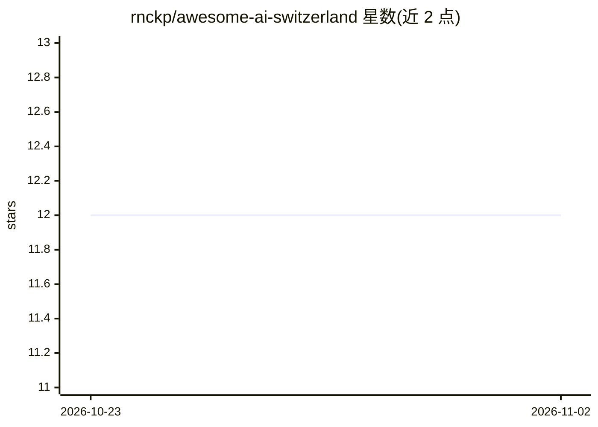

# rnckp/awesome-ai-switzerland

⭐ 12 · Python · CC0-1.0 · 推送 2026-10-31 · [GitHub](https://github.com/rnckp/awesome-ai-switzerland) · [官网](https://rnckp.github.io/awesome-ai-switzerland/) · 个人维护

**瑞士 Apertus 开源模型生态策展清单：模型、数据集、工具与研究**

社区维护的瑞士 AI Initiative Apertus 多语言模型家族生态清单：收录官方模型（1.5/1.1 Mini/1.0 系列，8B/70B/更小规模）、预训练与后训练代码、数据集与透明度档案、评测工具、本地推理与托管 API、社区量化衍生项目及应用集成。条目按目录组织并标注访问条件与许可差异；清单声明独立维护，与 Apertus 官方无隶属关系，CC0 许可。面向想使用、复现或研究 Apertus 的开发者与科研人员。

## 筛选速览

| 维度 | 判定 | 备注 |
|---|---|---|
| AI 角色 | `ai-knowledge` | 知识聚合/清单类 |
| 许可风险 | `viral` | CC0-1.0 |
| 部署形态 | `self-host` | docker 或自建部署 |
| 模型依赖 | local-ok | 支持本地模型 |
| 硬件要求 | — | 无带数字的原话,不猜 |
| 安装摩擦 | `low` | 无编译、无系统依赖或容器化 |
| 成熟度 | — | 结构信号不足 |

## 能力要点

- 覆盖 Apertus 1.5/1.1 Mini/1.0 全系官方模型与中间训练检查点
- 收录训练代码、数据重建、量化与微调 recipe 等复现资源
- 按模型、数据集、评测、本地推理、应用集成等类别分目录组织
- 声明为独立社区清单，非官方附属，CC0 许可

## 适用场景

- 查找 Apertus 模型权重、访问条件与本地运行方案
- 复现训练流程或获取后训练数据集
- 了解瑞士 AI 生态中的评测工具与社区衍生项目

## 场景标签

`精选清单` `科研工具` · 领域:学习与行业

## 证据(README 行号)

> L9: A curated guide to Apertus, the open multilingual model family from the Swiss AI Initiative, developed by EPFL, ETH 
> L15:  Table of Contents
> L11: > Independent, community-maintained list; not affiliated with, sponsored by, or endorsed by Apertus or its institut

## 星数曲线

2026-10-23 12 → 2026-11-02 12（+0）

---
*卡片 v1 · prompt 1.4 · 生成 2026-11-01 · 置信度 mid · 依据 README sha `d5a5eae53312` · [字段定义](../../DATASET.md)*
