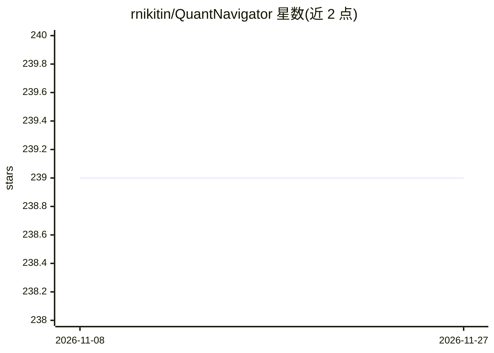

# rnikitin/QuantNavigator

⭐ 239 · MIT · 推送 2026-11-14 · [GitHub](https://github.com/rnikitin/QuantNavigator) · 个人维护

**规划中的量化研究工作台：用编码 agent 做可回溯的实验**

目前仓库仅包含产品愿景与路线图，尚无已发布的应用代码、运行时集成或安装命令，全部能力均处于规划状态。目标是做一个独立桌面应用：以多个人人工作区承载研究项目，保存问题、实验配置与结果工件供跨会话查阅，由人决定研究方向与结论；通过运行时连接将工作委托给编码 agent，并展示执行状态与失败；计划接入 Codex、Claude Code 和 Pi 等外部运行时，也可能基于 Pi 或 Mastra 构建原生运行时；研究能力通过插件与原生组件逐步引入。

## 筛选速览

| 维度 | 判定 | 备注 |
|---|---|---|
| AI 角色 | `ai-ecosystem` | LLM/agent 周边工具 |
| 许可风险 | `permissive` | MIT |
| 部署形态 | `None` |  |
| 模型依赖 | — | README 未给出锁定关系 |
| 硬件要求 | — | 无带数字的原话,不猜 |
| 安装摩擦 | `low` | 无编译、无系统依赖或容器化 |
| 成熟度 | `idea` | |

## 能力要点

- 多个人工作区，含研究项目、实验历史与会话结束后可检视的结果
- 向编码 agent 委托工作，展示执行状态与失败
- 计划接入 Codex、Claude Code、Pi 等运行时
- 研究能力通过插件与原生组件扩展

## 适用场景

- 在一个环境中管理量化研究的提问、实验与证据，供后续回溯
- 将实验任务委托给编码 agent 并追踪执行情况
- 做可复现的基线对比并检视指标与报告

## 场景标签

`编码 Agent` `金融量化` · 领域:编码与开发

## 证据(README 行号)

> L30: - Runtime connections for delegating work to coding agents, with visible
> L37: Planned external runtimes include Codex, Claude Code and Pi. Each integration

## 星数曲线

2026-11-08 239 → 2026-11-27 239（+0）

---
*卡片 v1 · prompt 1.4 · 生成 2026-11-18 · 置信度 low · 依据 README sha `5e6f9a17f57f` · [字段定义](../../DATASET.md)*
