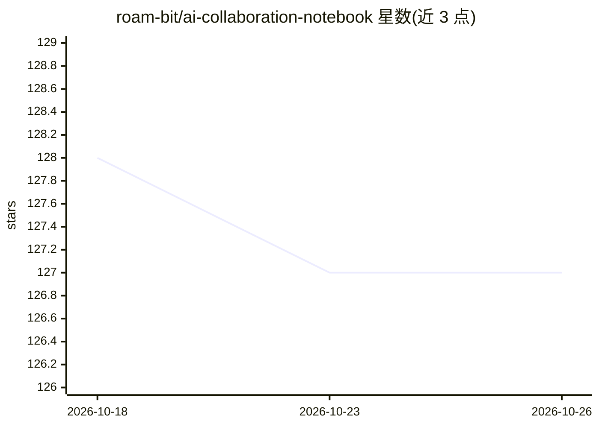

# roam-bit/ai-collaboration-notebook

⭐ 127 · MIT · 推送 2026-06-25 · [GitHub](https://github.com/roam-bit/ai-collaboration-notebook) · 个人维护 · 中文 README

**让 AI 记错题、自我迭代的协作机制与错题本文档框架**

一套以 Markdown 文档为核心的 AI 协作方法论：协作协议（17 条规则）+ 错题本（14 个脱敏案例，含现象/根因/预防规则）+ 自动加载层（CLAUDE.md/AGENTS.md），构成「观察层↔规则层↔加载层」闭环；同一根因复发 3 次升级为硬规则，配套规则退役机制。v3 新增巡检员 agent 定期扫会话日志补录漏记失误与量化指标账本。面向与 Claude/Cursor/Gemini/ChatGPT 等长期协作的用户，无代码安装，克隆仓库读文档即可使用。作者声明局限：不能让 AI 不犯错、不能跨工具直接迁移、仍需人工指出错误。

## 筛选速览

| 维度 | 判定 | 备注 |
|---|---|---|
| AI 角色 | `ai-knowledge` | 知识聚合/清单类 |
| 许可风险 | `permissive` | MIT |
| 部署形态 | `None` |  |
| 模型依赖 | — | README 未给出锁定关系 |
| 硬件要求 | — | 无带数字的原话,不猜 |
| 安装摩擦 | `low` | 无编译、无系统依赖或容器化 |
| 成熟度 | — | 结构信号不足 |

## 能力要点

- 三层架构：错题本观察池 + 协议规则 + 自动加载层
- 「事不过三」升级阈值与规则退役机制
- v3 巡检员 agent 半自动补录漏记失误与量化账本
- 14 个脱敏错题案例，每条含思维根因与预防规则

## 适用场景

- 长期与 AI 协作中沉淀自己的错题本与协作协议
- 降低 AI 重复同类错误的频率与纠正成本
- 按冷启动指南分阶段（记→升级→回顾）建立反馈循环

## 场景标签

`提示工程` `Agent 记忆` · 领域:Agent 开发

## 证据(README 行号)

> L38: 它由三份文档组成——一份 协作协议（AI 该怎么和你配合）+ 一份 错题本（AI 犯错时主动记录、复发 3 次升级为新协议）+ 一份 CLAUDE.md（自动加载层，触发上面两份的读取）。
> L130: |文件|用途|
> L136: |AGENTS.md|单文件合并版，给 AI 直接读|

## 星数曲线

2026-10-18 128 → 2026-10-26 127（-1）

---
*卡片 v1 · prompt 1.4 · 生成 2026-10-23 · 置信度 high · 依据 README sha `5a7c8fdd3983` · [字段定义](../../DATASET.md)*
