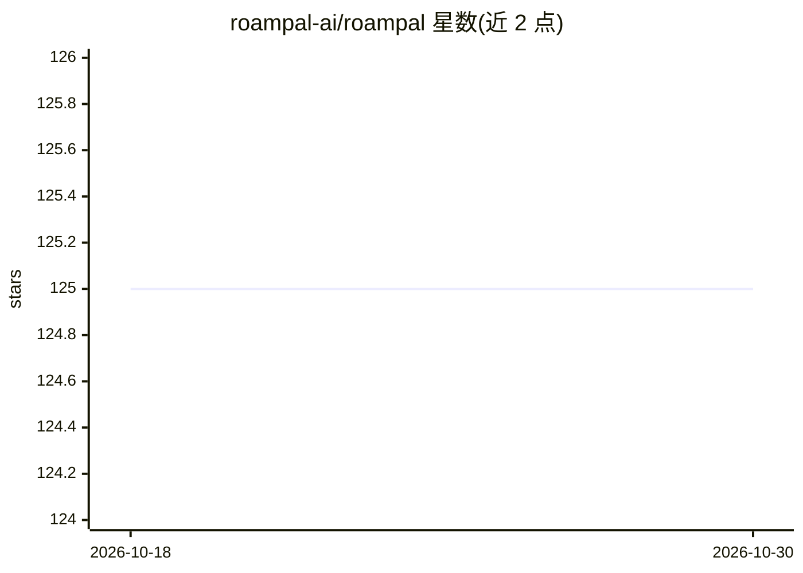

# roampal-ai/roampal

⭐ 125 · Python · NOASSERTION · 推送 2026-05-12 · [GitHub](https://github.com/roampal-ai/roampal) · [官网](https://roampal.ai/) · 组织维护

**本地优先的带持久记忆 AI 聊天桌面应用**

基于 Tauri 的桌面 AI 聊天应用（Python 3.10+），核心是五层记忆架构：通过对话中“有效/无效”反馈对记忆打分，好建议升为永久记忆、坏建议自动删除，跨会话召回；提供 Memory Bank、文档上传与 MCP 集成（Claude Desktop、Cursor 等 7 个工具）。检索采用 TagCascade + ONNX 交叉编码器重排，后台 Sidecar LLM 提取事实与标签。模型经 Ollama 或 LM Studio 本地运行，离线可用、无遥测。源码 Apache 2.0 免费，预编译可执行文件 $19.99。

## 筛选速览

| 维度 | 判定 | 备注 |
|---|---|---|
| AI 角色 | `ai-native` | 本体是模型或模型工具 |
| 许可风险 | `none` | NOASSERTION |
| 部署形态 | `desktop` | 安装包/桌面程序 |
| 模型依赖 | local-ok | 支持本地模型 |
| 硬件要求 | — | 无带数字的原话,不猜 |
| 安装摩擦 | `low` | 无编译、无系统依赖或容器化 |
| 成熟度 | — | 结构信号不足 |

## 能力要点

- 五层记忆架构，基于结果反馈（+0.2/-0.3）的记忆升降级与跨会话召回
- TagCascade 检索：标签路由 + ONNX 交叉编码器重排
- MCP 集成提供 7 个工具（search_memory、add_to_memory_bank 等）
- 100% 本地运行、离线可用、零遥测

## 适用场景

- 不想每次对话都重新解释背景的个人 AI 助手
- 把偏好、身份、目标存入 Memory Bank 并跨会话使用
- 上传 .txt/.md 文档作为可检索的个人知识库
- 通过 MCP 让 Claude Desktop、Cursor 等工具调用我的记忆

## 场景标签

`AI 助手` `知识库管理` · 领域:对话与助手

## 证据(README 行号)

> L15:  Roampal - AI Chat with Persistent Memory
> L36: - System learns through natural conversation, not transcript ingestion
> L80: - 100% local: All data on your machine

## 星数曲线

2026-10-18 125 → 2026-10-30 125（+0）

---
*卡片 v1 · prompt 1.4 · 生成 2026-10-23 · 置信度 high · 依据 README sha `502e97f25034` · [字段定义](../../DATASET.md)*
