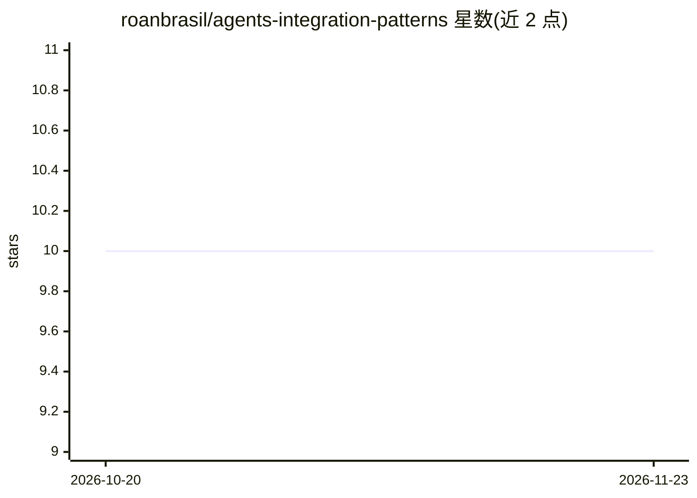

# roanbrasil/agents-integration-patterns

⭐ 10 · NOASSERTION · 推送 2026-06-24 · [GitHub](https://github.com/roanbrasil/agents-integration-patterns) · [官网](https://github.com/roanbrasil/agents-integration-patterns) · 个人维护

**为多智能体 AI 系统命名集成模式的模式目录**

借鉴企业集成模式的组织方式，为多智能体 AI 系统整理一套命名的集成模式词汇。以 MCP（纵向工具接入）与 A2A（横向代理协作）两个协议为集成基础，区分 Loop Engineering 与 Harness Engineering 两类工程学科，每个模式按意图、问题、方案、图示、后果、已知使用等字段结构化描述，覆盖消息、发现等类别，完整模式以 markdown 文件形式存放于仓库内。纯文档项目，无安装或运行要求。

## 筛选速览

| 维度 | 判定 | 备注 |
|---|---|---|
| AI 角色 | `ai-knowledge` | 知识聚合/清单类 |
| 许可风险 | `none` | NOASSERTION |
| 部署形态 | `None` |  |
| 模型依赖 | — | README 未给出锁定关系 |
| 硬件要求 | — | 无带数字的原话,不猜 |
| 安装摩擦 | `low` | 无编译、无系统依赖或容器化 |
| 成熟度 | — | 结构信号不足 |

## 能力要点

- 以 MCP 与 A2A 协议作为模式目录的协议基础
- 模式按 Intent/Problem/Solution/Consequences/Known Uses 等字段结构化描述
- 区分 Loop Engineering 与 Harness Engineering 两类工程学科并给出构建顺序建议
- 素材来源含 EIP、12-Factor Agents、A2A/MCP 规范与多篇 arXiv 论文

## 适用场景

- 为多智能体系统的架构评审建立统一术语
- 设计 agent 间通信、发现、容错结构时查找对应模式
- 了解 MCP 与 A2A 在集成架构中的分工与组合风险

## 场景标签

`多智能体` `教程课程` · 领域:Agent 开发

## 证据(README 行号)

> L3: > A catalog of integration patterns for multi-agent AI systems — the missing vocabulary between Enterprise Integrati
> L14: Yet we lack a shared vocabulary. Teams reinvent patterns with different names. Architecture reviews debate the same
> L84: Each pattern follows this structure:

## 星数曲线

2026-10-20 10 → 2026-11-23 10（+0）

---
*卡片 v1 · prompt 1.4 · 生成 2026-11-19 · 置信度 high · 依据 README sha `751e784a4168` · [字段定义](../../DATASET.md)*
