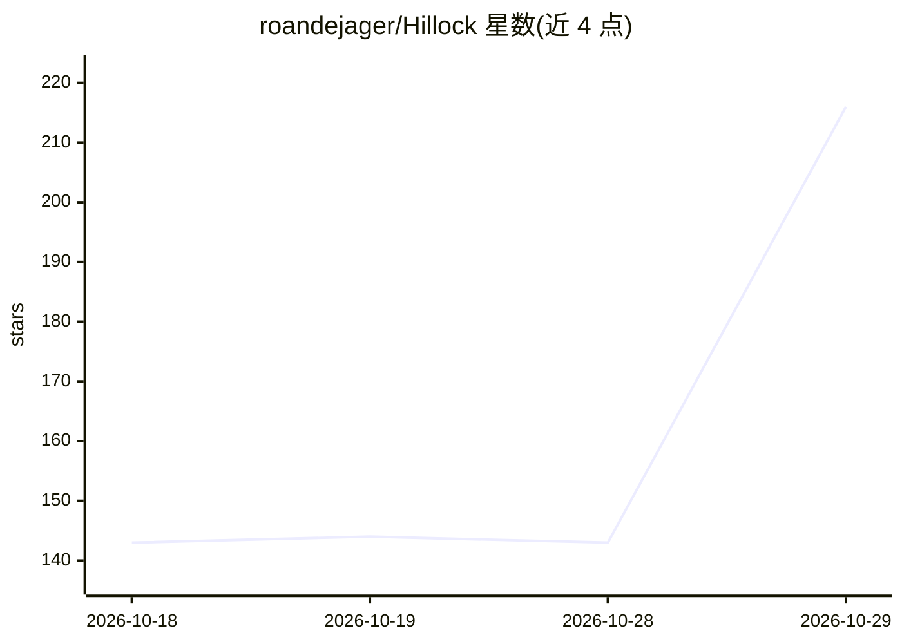

# roandejager/Hillock

⭐ 216 · Python · AGPL-3.0 · 推送 2026-10-28 · [GitHub](https://github.com/roandejager/Hillock) · 个人维护

**本地超维计算记忆引擎：为边缘硬件提供低显存 RAG 替代**

面向边缘硬件的 100% 本地记忆引擎，采用三层架构：SQLite 关系知识图谱、Hebbian 突触记忆与超维计算（HDC/VSA）。用张量分类而非 LLM 读取文档，通过数学门控在问题到达 LLM 前拦截不可回答的提问，整个流水线可在 1.2 GB 显存以下或纯 CPU 运行。以 Python 库、终端控制台与 OpenAI 兼容 API 服务器三种方式使用，可接入 Open-WebUI、AnythingLLM 等 UI，前置条件为 Python 3.10+ 与本地 Ollama。采用 AGPL-3.0 与商业闭源双许可。

## 筛选速览

| 维度 | 判定 | 备注 |
|---|---|---|
| AI 角色 | `ai-ecosystem` | LLM/agent 周边工具 |
| 许可风险 | `dual` | AGPL-3.0 |
| 部署形态 | `library` | 以包/库形式分发 |
| 模型依赖 | local-ok | 支持本地模型 |
| 硬件要求 | `cpu-ok` | |
| 安装摩擦 | `low` | 无编译、无系统依赖或容器化 |
| 成熟度 | — | 结构信号不足 |

## 能力要点

- 三层架构：SQLite 知识图谱 + Hebbian 突触记忆 + 超维计算（HDC）
- 数学门控在问题到达 LLM 前拦截不可回答提问
- 整条流水线 <1.2 GB 显存，可纯 CPU 运行；30 句文档约 5 秒摄取
- v0.6.x 起提供 OpenAI 兼容 API 服务器与 ONNX CPU 谓词路由（可选）

## 适用场景

- 在中低端 GPU 或纯 CPU 设备上本地搭建文档问答记忆层
- 把无幻觉记忆接入 Open-WebUI / Obsidian / AnythingLLM 等 UI
- 作为 Python 库嵌入自己的应用提供知识图谱记忆

## 场景标签

`Agent 记忆` `文档问答` `知识图谱` · 领域:Agent 开发

## 证据(README 行号)

> L15: Hillock was built to solve this. It replaces bloated vector databases and token-hungry extraction passes with a lig
> L23: * **API Ready (New in v0.6.x):** Hillock now includes an OpenAI-compatible API server. You can plug its hallucinati
> L71: ### 1. The API Server (For Custom UIs)

## 星数曲线

2026-10-18 143 → 2026-10-29 216（+73）

---
*卡片 v1 · prompt 1.4 · 生成 2026-10-22 · 置信度 mid · 依据 README sha `8397a6795b93` · [字段定义](../../DATASET.md)*
