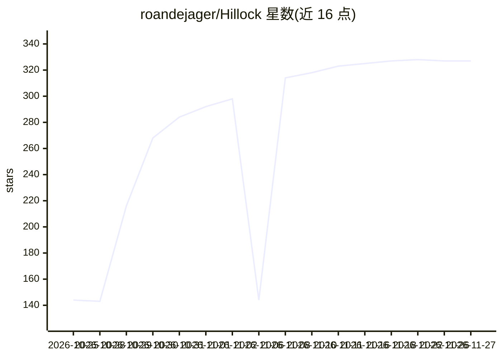

# roandejager/Hillock

⭐ 327 · Python · AGPL-3.0 · 推送 2026-11-18 · [GitHub](https://github.com/roandejager/Hillock) · 个人维护

**本地运行的神经符号记忆引擎，为离线 LLM 提供事实门控**

以 SQLite 知识图谱、超维计算位向量门控和 Hebbian 可塑性记忆三层结构实现的本地记忆引擎：摄入文档时用轻量编码器抽取事实三元组，提问时先验证事实关系是否存在，未验证则阻断提示并拒绝回答。内置 OpenAI 兼容 FastAPI 服务器（/v1/chat/completions，支持流式）可接入外部 UI；也提供无 LLM 的纯 Python headless 模式作为确定性事实库。需 Python 3.10+，可完全离线在普通笔记本 CPU 或 1.2 GB VRAM 内运行。

## 筛选速览

| 维度 | 判定 | 备注 |
|---|---|---|
| AI 角色 | `ai-ecosystem` | LLM/agent 周边工具 |
| 许可风险 | `dual` | AGPL-3.0 |
| 部署形态 | `library` | 以包/库形式分发 |
| 模型依赖 | local-ok | 支持本地模型 |
| 硬件要求 | `gpu-8g` | |
| 安装摩擦 | `low` | 无编译、无系统依赖或容器化 |
| 成熟度 | — | 结构信号不足 |

## 能力要点

- 生成前事实门控：未验证的关系阻断提示，触发拒绝而非猜测
- SQLite 三元组图 + 10,000 位超维向量 CPU 位运算相似度（<1 毫秒）
- 内置 OpenAI 兼容 API 服务器，支持 AnythingLLM/Open-WebUI 直接接入
- 纯 CPU 运行，headless 模式无需 LLM（子 200MB 内存）

## 适用场景

- 为本地 AI agent 提供可拒绝无据回答的事实记忆库
- 低配硬件上离线运行文档问答，避免向量库内存开销
- 通过 OpenAI 兼容端点把记忆能力接入现有 Web UI 或桌面应用

## 场景标签

`Agent 记忆` `知识图谱` `文档问答` · 领域:Agent 开发

## 证据(README 行号)

> L30: Includes a built-in FastAPI server that exposes standard `/v1/chat/completions` endpoints with streaming support. Y
> L99: If you are building an autonomous agent or custom script and just want a fast, deterministic fact database without 
> L118: **3. Vector Symbolic Gating (`reservoir.py`)**

## 星数曲线

2026-10-25 144 → 2026-11-27 327（+183）

---
*卡片 v1 · prompt 1.4 · 生成 2026-11-25 · 置信度 high · 依据 README sha `03b14f6ef565` · [字段定义](../../DATASET.md)*
