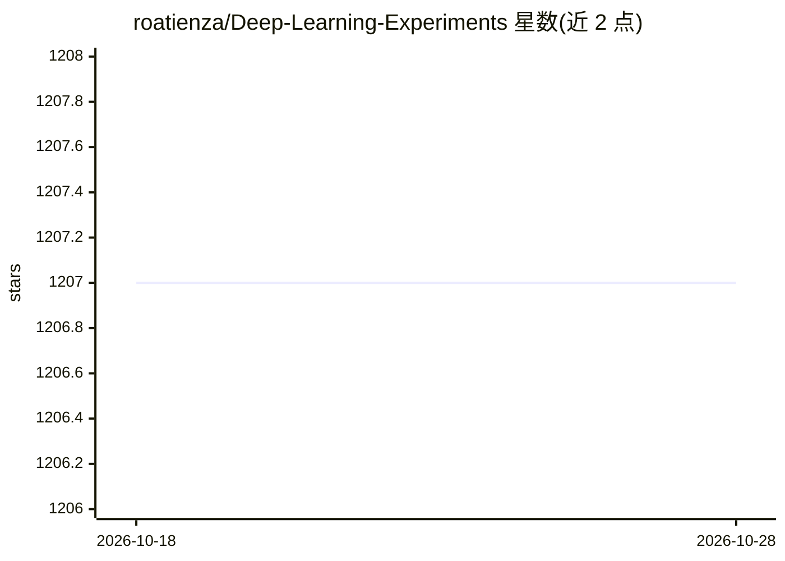

# roatienza/Deep-Learning-Experiments

⭐ 1,207 · Jupyter Notebook · MIT · 推送 2026-09-26 · [GitHub](https://github.com/roatienza/Deep-Learning-Experiments) · 个人维护

**深度学习课程讲义与实验代码合集（讲义+笔记本+视频）**

包含理论与实操两部分的教学资料库：理论部分覆盖 MLP、CNN、RNN、Transformer、Mamba、GAN、扩散模型、LLM、Agent 等主题，配 PDF 讲义与 Notebook 实验代码；实操部分涵盖 Python、PyTorch、Gradio、模型打包（ONNX/TensorRT/PyTriton）等工程技能，部分主题附视频。实验代码基于 PyTorch，通过 requirements.txt 安装依赖后运行，面向深度学习学习者。

## 筛选速览

| 维度 | 判定 | 备注 |
|---|---|---|
| AI 角色 | `ai-knowledge` | 知识聚合/清单类 |
| 许可风险 | `permissive` | MIT |
| 部署形态 | `library` | 以包/库形式分发 |
| 模型依赖 | — | README 未给出锁定关系 |
| 硬件要求 | — | 无带数字的原话,不猜 |
| 安装摩擦 | `low` | 无编译、无系统依赖或容器化 |
| 成熟度 | — | 结构信号不足 |

## 能力要点

- 理论与实操两大板块，主题从基础 MLP 到 Mamba、扩散模型、LLM、Agent
- 提供 PDF 讲义、教学指南与 Notebook 实验代码
- 实操含模型打包部署：ONNX、TensorRT、PyTriton、TorchScript

## 适用场景

- 系统学习深度学习理论并配套动手实验
- 学习模型打包与部署（ONNX/TensorRT）的工程实践
- 作为教学参考讲义使用

## 场景标签

`教程课程` · 领域:学习与行业

## 证据(README 行号)

> L1: # Deep Learning Lecture Notes and Experiments
> L9: |**Topic**|**Slides**|**Teaching Guide**|**Code**|
> L33: |**Topic**|**Note**|**Video**|**Code**|

## 星数曲线

2026-10-18 1,207 → 2026-10-28 1,207（+0）

---
*卡片 v1 · prompt 1.4 · 生成 2026-10-21 · 置信度 high · 依据 README sha `4aff22cb61f5` · [字段定义](../../DATASET.md)*
